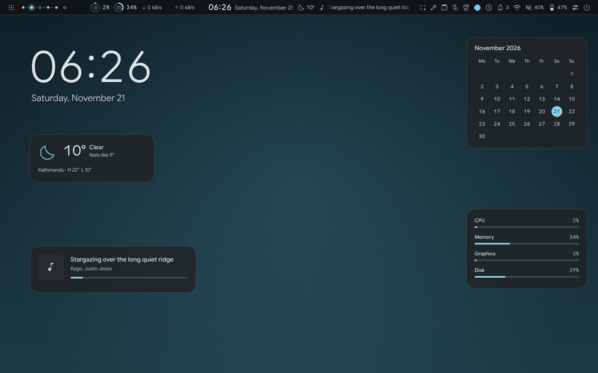
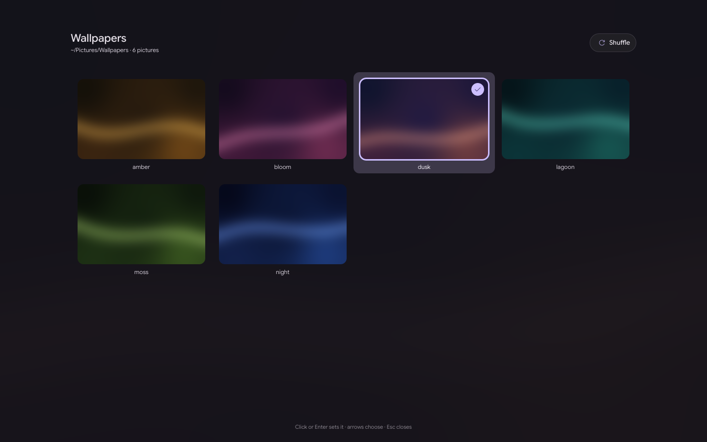
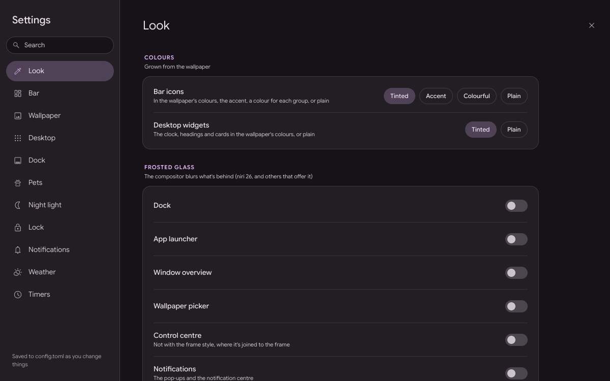
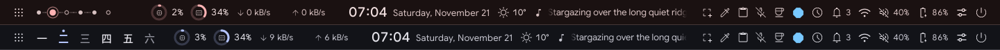
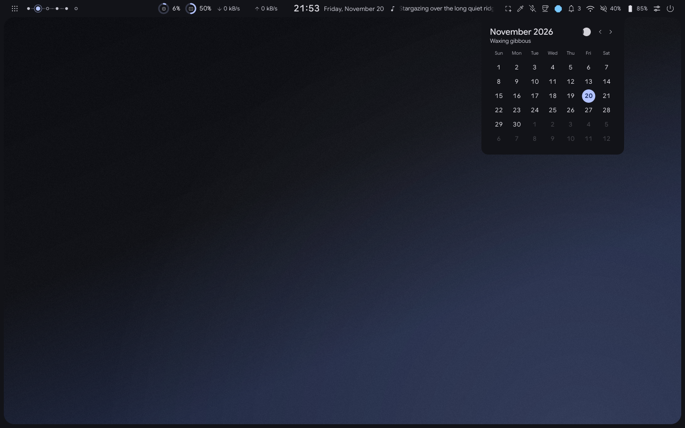
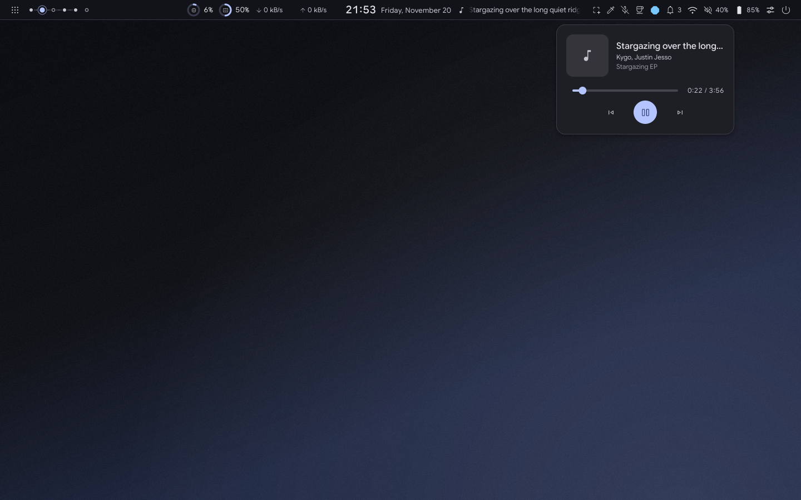

# Asterism

A quiet, minimal desktop shell for **niri** and **Hyprland**, written in pure Rust.

A slim bar with a hairline under it, menus that float just off it as outlined cards, and colours
grown from your wallpaper. Around the bar, everything a desktop needs, in the same language: a
full-screen app launcher, a window overview, a control centre, notifications, a lock screen,
desktop widgets, a wallpaper changer, a settings app, clipboard history, screenshots, timers,
weather, night light, and password prompts for polkit, Wi-Fi and Bluetooth.

No GTK, no Qt, no QML: it talks Wayland directly (layer-shell, xdg popups, fractional scaling,
session lock, data control, gamma control) and draws everything on the CPU with tiny-skia,
cosmic-text and resvg.

| | |
|---|---|
|  |  |
| The bar and the control centre | The launcher |
|  |  |
| The window overview | Widgets on the desktop |
|  |  |
| The wallpaper changer | Settings |

- [The look](#the-look)
- [The bar](#the-bar)
- [Finding things](#finding-things): launcher, overview, clipboard, shortcuts
- [Your desktop](#your-desktop): wallpaper, widgets, night light
- [Day to day](#day-to-day): control centre, notifications, settings, dashboard, timers, weather
- [Security and devices](#security-and-devices): lock screen, polkit, Wi-Fi, Bluetooth
- [Screenshots and recording](#screenshots-and-recording)
- [What leaves your machine](#what-leaves-your-machine)
- [Requirements](#requirements) · [Install](#install) · [Keybinds](#keybinds) · [Configure](#configure) · [Hacking](#hacking)

## The look

- **Colour from your wallpaper.** The whole scheme (a dark Material 3 one) grows from the colour
  that stands out most in your wallpaper, and grows again when you change it. Or pick the colour
  yourself with `[colors] accent`. The bar's icons and the desktop's widgets take it on too, and
  change with every new wallpaper: tinted toward it (the default), in its accent, a colour per
  group of icons, or plain (`[colors] bar_icons` and `widgets`, or Settings → Look). Your
  terminal and GTK apps can follow it as well (below).
- **Flat surfaces with a hairline.** The bar is a solid strip; menus, panels and pop-ups are
  cards with a 1 px outline and a soft shadow. Pointing at something in the bar draws a short
  accent underline under it.
- **Workspaces, three ways.** An *asterism* is a small pattern of stars, and that's the default:
  a dot per workspace, the busy ones joined by a thin line, the one you're on ringed in the
  accent. Or plain numbers. Or kanji — 一 二 三 … — with the one you're on in the accent and a
  *bōten* (傍点), the emphasis dot Japanese type sets over a character. Choose in Settings → Look
  → Workspaces, or with `page_style` in the config.

  

  The picture shows six workspaces, several with windows. niri keeps only the workspaces you use
  plus one empty one after them, so with windows on one workspace the dots are just a ringed dot
  and a hollow one; the line joining them appears once two or more workspaces have windows.

- **Five styles.** `line` (the default), `frame` (a thin frame round the screen with rounded
  inner corners, menus hanging from the bar like drawers), `floating`, `islands` and
  `transparent`.

  

## The bar

| Module | Shows | Click | Right click | Scroll |
|---|---|---|---|---|
| `launcher` | An apps button | The launcher | | |
| `pages` | Workspaces as joined dots, numbers or kanji. Point at one to see what's open there. | Go there | The window overview | Next / previous workspace |
| `clock` | Time and date | Calendar with the moon's phase | | |
| `weather` | The weather where you are | Now, sunrise and sunset, the next five days | | |
| `media` | What's playing (MPRIS), sliding by when long | Cover, progress, controls, other players | Play / pause | |
| `resources` | CPU and memory rings, temperature, network speed | The dashboard, or traffic | | |
| `tray` | Background apps (StatusNotifierItem) | Activate | The app's menu | Scroll the app |
| `tools` | Screenshot and recording, colour picker, clipboard history, microphone, stay awake | Their menu, run, or toggle | | |
| `status` | Timers, notifications, keyboard layout, network, Bluetooth, volume, battery, control centre, settings, session; a red dot and the time while recording | Their menus | Mute, Bluetooth on/off, do not disturb | Volume |

The menus: calendar, music, sound (volume, brightness, output device, microphone, per-app
volume), network (Wi-Fi on/off, networks nearby, your saved VPNs with a switch each),
Bluetooth (your devices with their charge, devices nearby; a device running low says so),
battery (level, time left, power profiles), timers, weather, screenshot, session (lock, sleep,
log out, restart, shut down; the last three ask for a second click), traffic, keyboard layouts,
notifications, and every tray app's own menu.



Menus taller than the screen scroll. They also work from the keyboard:

| Key | Does |
|---|---|
| Up / Down, Tab / Shift+Tab | Move between items (the menu scrolls to follow) |
| Home / End, Page Up / Page Down | Jump to the ends, or a page at a time |
| Enter / Space | Activate |
| Left / Right | Nudge a slider (5%, or 5 s on a track), change month in the calendar, open or leave a tray submenu |
| Esc | Close, or step out of a tray submenu |

## Finding things

**The launcher** — the apps button, or `asterism msg launcher`. The whole screen: a search field
over a grid of your apps spanning 80% of the width, in alphabetical order so each keeps its
place, with a dot per page at the bottom. Typing narrows it to the best matches (names, initials
like `vsc` for Visual Studio Code, keywords, descriptions), the apps you use most first. Apps
start in their own systemd scope, so restarting the shell never takes them down. It also does:

| Type | Gets you |
|---|---|
| `2*pi`, `= sqrt(2)` | The result; Enter copies it |
| `> command` | Runs it |
| `>ssh name` | The hosts in `~/.ssh/config`; Enter connects in your terminal |
| `:heart` | Emoji by name; Enter copies one |
| `? question` | A web search |

Arrows move round the grid, Tab steps, Page Up/Down or the wheel turn the page, Enter opens,
Backspace / Ctrl+W / Ctrl+U erase a letter, a word, everything, Esc closes.

**The window overview** — Mod+O (below), `asterism msg overview`, or a right-click on the
workspaces. Every workspace as a card, with a map of its windows in their real columns and sizes,
each with its app's icon and title. Click a window to go to it, a card to go to that workspace;
drag a window onto another card to move it there; middle-click (or Delete) closes one. Type to
find a window by title or app; the arrows and Enter work too. (There are no live thumbnails:
niri doesn't let other programs capture single windows.)

**Clipboard history** — the tools' clipboard button, Mod+Ctrl+V, or `asterism msg clipboard`.
What you've copied, text and pictures, newest first: type to search, Enter puts one back on the
clipboard, Delete forgets it. It's kept in memory only (never written to disk), the last 50 with
at most 8 pictures, and anything a password manager marks as secret is never read.

**Keyboard shortcuts** — Mod+Shift+/ or `asterism msg shortcuts`: a sheet of your compositor's
binds (niri's `binds { }`, Hyprland's `bind =` lines), grouped, with keycaps. Type to narrow it.

## Your desktop

**The wallpaper, and changing it.** On every output: your picture (`cover`, `contain` or
`stretch`), else a quiet gradient in the scheme's colours, or a painted landscape (`world =
true`). The changer — Mod+W, the control centre's Wallpaper tile, or `asterism msg wallpaper` —
shows your wallpaper folder as a full-screen grid of thumbnails, the one up now ringed. Click one
(or the arrows and Enter) and it's up at once, colours and all; Shuffle (or R, or Mod+Shift+W)
picks one at random, and `interval` (Settings → Wallpaper → Change by itself) changes it on its
own every so many minutes. Your choice is remembered without rewriting your config.
`enabled = false` leaves the wallpaper to another program.

Pictures change with an animation, a different one each time: a fade, a wipe from any side or
corner, a circle growing from the middle, a corner or somewhere at random, blinds, ink spreading
in soft blots, pixels turning over, or the new picture sliding in. Pick one, or none, with
`[wallpaper] transition` (Settings → Wallpaper → Animation), and its length with
`transition_ms`. Both pictures are painted afresh for the change and let go of after it, so the
animation costs no memory the rest of the time.

**Widgets on the desktop.** On the wallpaper, under your windows: a big clock, the weather, what's
playing (cover, progress, and the song's words line by line, from LRCLIB), a visualizer whose bars
move with the music while something plays (in a card, or along the foot of the screen), a month
calendar, the machine's load, a photo frame (a picture from a folder, a new one every few
minutes) and a sticky note. Drag one to move it; it stays where you leave it, on any screen size.

**The desktop's menu.** Right-click the wallpaper for: arrange widgets, change the wallpaper (or
take another at random), settings. Right-click a widget and the menu starts with that widget:
take it off, write the note, show the next picture.

To arrange them, choose Arrange widgets there, press Arrange in Settings → Desktop, or run
`asterism msg widgets edit`. The screen dims and the widgets come up above your windows, each in
a frame with a × to take it off; a strip at the top puts the others on. Drag to move (they snap
to an 8 px grid), and turn the wheel on one to make it bigger or smaller (60% to 200%). Widgets
with nothing to show yet (what's playing, the visualizers) stand in as placeholders so you can
place them anyway. Esc, Enter or Done finishes. The list is `[widgets] show` in the config.

The visualizers listen to what your speakers play (`parec` on the default output's monitor, or
`pw-record`), only while one is on the desktop (or the new-song card shows) and a player is
playing; the sound never leaves the shell, and it isn't counted as a microphone in use.

**Colours for your apps.** With `[colors] apps` (or the switches in Settings → Look), the
scheme is written for kitty, foot, Alacritty and GTK as files of their own, next to their
configs: `asterism-colors.conf`, `.ini`, `.toml` or `.css`. Your own config files are never
touched; include the file once (Settings shows the line for each) and the app follows every
wallpaper change. The sixteen terminal colours keep their meaning, red still red, leaning a
little toward the wallpaper's colour. kitty takes the change at once, Alacritty when the file
changes, foot and GTK apps at their next start.

**Night light.** Warmer colours in the evening, through the compositor's gamma control (no extra
program). A tile in the control centre turns it on or off until the schedule next turns over;
`[night_light] mode = "schedule"` warms the screen from sunset to sunrise (or set times), easing
in and out over 20 minutes.

## Day to day

**The control centre** — the button beside the power icon, the bar's top-right corner, Mod+A,
or `asterism msg control`. The time; quick tiles (Wi-Fi, VPN when one's saved, Bluetooth, do not disturb, stay awake,
microphone, power profile, night light, wallpaper, settings); volume and brightness; what's
playing; notifications grouped by app; and lock, sleep, log out, restart, shut down (the last
three ask twice). Esc or a click beside it closes it.

**A pet.** A cat, a fox or a bird lives on your screen, above the windows. The cat and the fox
walk along the foot of the screen; the bird flies about, hops, and perches on the bar. Each has
a real coat to choose from (a tabby, ginger, black, white, tuxedo or Siamese cat; a red or arctic
fox; a sparrow, robin or bluebird) or the wallpaper's colours, blinks, and follows things with
its eyes.

It behaves like a pet: it has energy (it naps when tired), hunger (it asks to be fed) and wants
attention (ignored a while, it comes to find you). It loafs, grooms, lies about, stretches and
yawns when it wakes; falls asleep after a minute without input; gets the zoomies when the
machine is busy; sways to music; perks up when a notification comes. Where the shell can see your
pointer (over the desktop and the bar) it runs over to it, and when it's low and near, crouches,
wiggles and pounces.

Click it to stroke it: it purrs, eyes shut, a heart over it. Drag it to pick it up: it dangles,
and lands on its feet when you let go (complaining if you dropped it from high). Right-click it to
**feed** it (a bowl appears and it goes to eat) or **play** (a ball it chases and bats about;
click the ball to kick it), for another animal, or to put it away. It speaks now and then with a
small bubble and a sound: meows, trills and purrs for the cat, yips for the fox, chirps for the
bird, made by Asterism itself (no recordings), played quietly, and never in do-not-disturb or
while the screen is locked. Clicks anywhere else pass straight through.

A **second pet** (`[pet] friend`) keeps the first company: they go over to say hello, start a
game of chase (one runs at the other, which runs off), lie down beside each other when one's
asleep, and bat the same toys. **Yarn** is a second toy, softer than the ball, trailing a
thread. Give them a **bed** from the menu and they go to it to nap, and when you're away; it
stays where it was put. While a pet sits still its picture steps (six times a second, four
asleep) rather than gliding, so most of the time nothing needs painting at all.

Settings → Desktop → Pet (animal, coat, a second pet, sounds, volume, size), or `[pet]` in the
config; `asterism msg pet feed|play|yarn|bed|nobed|next|away` and `pet friend next|away` for
keybinds.

**A workspace at a glance.** Rest the pointer on a workspace dot for a moment and a small card
shows its windows where they sit, each with its app's icon, the focused one outlined.

**A new song** shows a small card under the bar for a few seconds: its cover, its name and its
singer, the music moving under them. Not while the music's menu or the control centre is open;
`song_popup = false` turns it off.

**Notifications.** Asterism is the notification daemon when no other one runs: pop-ups with
pictures and action buttons, a centre on the bell (Mod+N) with do not disturb and clear all,
critical ones that stay until you answer; point at a pop-up and it waits. Noisy apps can be told
to stay quiet (kept in the centre, no pop-up) or be dropped, in `[notifications.apps]` or in
Settings. The battery says so when it runs low, and again, urgently, when it's nearly empty. If
another daemon already runs (mako, swaync, another shell), Asterism leaves it be.

**Settings** — the control centre's Settings tile, the gear in the bar, or `asterism msg
settings`: the look, the bar, wallpaper, desktop widgets, night light, lock, notifications
(with a rule for each app that has notified), weather and timers, as switches, choices and
steppers. It's a window like any app's: the compositor tiles it, moves it and closes it (hold
the sidebar or the page's title to move it; Ctrl+W, Ctrl+Q or the × close it). Its app id is
`asterism-settings`, for window rules — say, to open it floating on niri:

```kdl
window-rule {
    match app-id="^asterism-settings$"
    open-floating true
}
```

Type anywhere in the window (when you're not typing into a value) to search every page; Esc
clears it. Each change is written to `config.toml` at once, keeping your comments and order. Every option is
also in [config.example.toml](config.example.toml) for editing by hand.

**The dashboard** — the CPU and memory rings, or `asterism msg dashboard`. Graphs of the
processor, memory, graphics card and network over the last two minutes, how full each disk is,
and what's running, by CPU or by memory. End stops one of yours (it asks twice, and never offers
to end the session itself: niri, systemd, Asterism, PipeWire…).

**Timers.** The timer in the bar: a countdown (1 min to 2 h, +1 min, pause), a focus timer (25
minutes of focus, 5 off, 15 after every fourth round; all in `[timers]`) and a stopwatch with
laps. While one runs, the bar shows a ring and the time left; a notification says when time's
up. Also `asterism msg timer 25`, `msg focus`, `msg stopwatch`.

**Weather.** In the bar beside the clock, from Open-Meteo, for `[weather] city` (or
`latitude`/`longitude`), else the city your time zone is named after. Its menu has the feel,
humidity, wind, sunrise and sunset, and the next five days.

**The level.** Volume, brightness and keyboard layout changes show a small level at the bottom of
the screen, whatever made the change. Brightness goes through logind, no root needed.

## Security and devices

**The lock screen.** Your wallpaper, dimmed; the time; your name; a password field (a dot for
each character). It locks on Mod+Alt+L or `asterism msg lock`, when logind is asked to (the
session menu's Lock, `loginctl lock-session`), before the machine sleeps — so closing the lid
locks too — and after `[lock] idle` minutes without input ("Stay awake" holds that off).

- It's a process of its own, `asterism-lock`, so nothing that happens to the bar can unlock the
  screen or lock you out.
- Your password is checked by the system's `unix_chkpwd`, the helper every PAM screen locker
  ends up asking; Asterism never reads `/etc/shadow` and links no PAM.
- With a fingerprint reader fprintd supports and a finger enrolled (`fprintd-enroll`), touching
  the reader unlocks it too (`[lock] fingerprint`).
- **If it ever won't take your password:** press Ctrl+Alt+F3, log in there, run `asterism
  unlock`, then switch back to your session (often Ctrl+Alt+F2 or F1).

**Polkit.** When an app needs an administrator's say, Asterism asks for the password on a card
(each character a dot). It's checked by polkit's own helper, never by Asterism, and wiped from
memory once used. If another agent already serves your session, Asterism leaves it be
(`polkit_agent = false` turns this off).

**Wi-Fi passwords.** A secured network you haven't joined before asks for its password on the same
kind of card. It goes to NetworkManager directly, never on a command line, and is kept only if it
works; a wrong one says so and lets you try again. Networks that need more than a password
(802.1X) are marked in the menu.

**Bluetooth pairing.** Opening the Bluetooth menu looks around for half a minute; devices in reach
show under Nearby, and a click pairs, trusts and connects one. Asterism is BlueZ's pairing agent,
so whatever the device asks comes up on a card: a number to check on both, a PIN or passkey to
type, a code to type on the device, or whether to let it in (when a phone starts the pairing, or
a device wants a service). Right-click a paired device twice to forget it.

## Screenshots and recording

The tools' screenshot button opens a menu: a region you choose, the whole screen, or the window
in focus (niri's own screenshot UI; grim and slurp on Hyprland). A notification shows each with a
thumbnail. Recording the screen, with or without sound, needs `wf-recorder`; while it runs the bar
shows a red dot and the time, and a click stops it. Recordings go to `~/Videos/Recordings`. Also
`asterism msg screenshot [region|screen|window]` and `msg record [audio]`.

**Text off the screen**: "Copy text from a region" in the same menu (or `msg screen-text`): choose
a region and the text in it is read and copied, with a notification showing what was found.
It needs `slurp`, `grim` and `tesseract`; the picture goes straight from one to the next through
a pipe, never to disk, and nothing leaves your machine.

## What leaves your machine

Only these, and only when you use them:

| What | Sent to | Contains |
|---|---|---|
| Weather | [Open-Meteo](https://open-meteo.com) | The place: the city name you set (or your time zone's), then its coordinates |
| Song words | [LRCLIB](https://lrclib.net) | The song playing: artist, title, album, length (`[widgets] lyrics = false` stops it) |
| Album covers | The player's own cover address | Whatever the player points at |
| `?` in the launcher | Your search engine (`[launcher] search`) | Your question |

Nothing looks you up by your IP address, and nothing else is sent anywhere.

## Requirements

- **niri**, or **Hyprland** (0.55+ with the Lua config, or older hyprlang versions — Asterism
  sends dispatchers in whichever form your Hyprland answers to).
- Rust 1.88 or newer to build.
- At run time, all optional — the shell shows what it can find:
  - `pactl` (PipeWire's pulse server or PulseAudio) for sound
  - NetworkManager, UPower and power-profiles-daemon over D-Bus; BlueZ (`bluetooth.service`
    running) for Bluetooth and pairing
  - `unix_chkpwd` (part of Linux-PAM, on every desktop system) for the lock screen; fprintd for
    fingerprint unlock
  - `curl` for the weather, lyrics and album covers; `wl-copy` to copy from the launcher
  - `parec` (PulseAudio's or pipewire-pulse's tools) or `pw-record` for the music visualizer
  - a CJK font such as Noto Sans CJK for kanji workspaces; Noto Color Emoji (or another colour
    emoji font) for emoji in the launcher
  - `wf-recorder` to record the screen; on Hyprland, `grim` and `slurp` for screenshots

The only system library it links is libxkbcommon (for typing with your keyboard layout), which
every Wayland desktop already has.

## Install

```sh
cargo build --release
install -Dm755 target/release/asterism ~/.local/bin/asterism
mkdir -p ~/.config/asterism && cp config.example.toml ~/.config/asterism/config.toml
```

After a rebuild, run the `install` line again and restart the shell (`pkill -x asterism`, then
start it again, or log out and in): the running one keeps the old binary. Restarting never touches
an open lock screen, which runs as `asterism-lock`.

Then start it with your session.

**niri** — in `~/.config/niri/config.kdl`. niri may not have `~/.local/bin` on its `PATH`, so the
full path is the safe choice (in the binds below too):

```kdl
spawn-at-startup "/home/you/.local/bin/asterism"
```

**Hyprland, Lua config (0.55+)**:

```lua
hl.on("hyprland.start", function()
    hl.exec_cmd("asterism")
end)
```

**Hyprland, hyprlang config (before 0.55)**:

```ini
exec-once = asterism
```

**Or with systemd**, for either compositor when your session starts `graphical-session.target`
(niri-session, uwsm):

```sh
install -Dm644 contrib/asterism.service ~/.config/systemd/user/asterism.service
systemctl --user enable --now asterism.service
```

**Coming from another shell?** Stop it from starting with your session (comment out its
`spawn-at-startup` line), and move the keybinds that called it over to `asterism msg …` (below).
Look at your lid switch too: one that asked the old shell to lock and suspend does nothing once
it's gone. Asterism locks before any sleep by itself, so plain suspend is enough:

```kdl
switch-events {
    lid-close { spawn "systemctl" "suspend"; }   // Asterism locks first
}
```

Another bar can also run alongside: if one already owns the tray, Asterism joins it as a second
host; if another shell is the notification daemon, Asterism leaves notifications to it.

## Keybinds

`asterism msg …` drives the running shell; `asterism msg help` lists every command.

**niri** (`~/.config/niri/config.kdl`, inside `binds { }`; use the full path to `asterism` if it
isn't on niri's `PATH`). These keys are free in niri's default config — Mod+C there centres a
column, so the control centre goes on Mod+A:

```kdl
Mod+Space hotkey-overlay-title="Apps" { spawn "asterism" "msg" "launcher"; }
Mod+O hotkey-overlay-title="Window overview" { spawn "asterism" "msg" "overview"; }
Mod+A hotkey-overlay-title="Control centre" { spawn "asterism" "msg" "control"; }
Mod+N hotkey-overlay-title="Notifications" { spawn "asterism" "msg" "notifications"; }
Mod+Ctrl+V hotkey-overlay-title="Clipboard history" { spawn "asterism" "msg" "clipboard"; }
Mod+W hotkey-overlay-title="Change the wallpaper" { spawn "asterism" "msg" "wallpaper"; }
Mod+Shift+W hotkey-overlay-title="A random wallpaper" { spawn "asterism" "msg" "wallpaper" "random"; }
Mod+Shift+Slash hotkey-overlay-title="Keyboard shortcuts" { spawn "asterism" "msg" "shortcuts"; }
Mod+Alt+L hotkey-overlay-title="Lock the screen" { spawn "asterism" "msg" "lock"; }
Mod+Shift+Escape { spawn "asterism" "msg" "menu" "session"; }
```

The volume, brightness and media keys can stay on `wpctl`, `brightnessctl` and `playerctl`:
Asterism shows its level for changes from anywhere. Or route them through it:

```kdl
XF86AudioRaiseVolume allow-when-locked=true { spawn "asterism" "msg" "volume" "up"; }
XF86AudioLowerVolume allow-when-locked=true { spawn "asterism" "msg" "volume" "down"; }
XF86AudioMute allow-when-locked=true { spawn "asterism" "msg" "volume" "mute"; }
XF86AudioMicMute allow-when-locked=true { spawn "asterism" "msg" "mic" "mute"; }
XF86MonBrightnessUp allow-when-locked=true { spawn "asterism" "msg" "brightness" "up"; }
XF86MonBrightnessDown allow-when-locked=true { spawn "asterism" "msg" "brightness" "down"; }
XF86AudioPlay allow-when-locked=true { spawn "asterism" "msg" "media" "play-pause"; }
XF86AudioNext allow-when-locked=true { spawn "asterism" "msg" "media" "next"; }
XF86AudioPrev allow-when-locked=true { spawn "asterism" "msg" "media" "previous"; }
```

**Hyprland**: the same commands with an exec bind, for example in hyprlang

```ini
bind = SUPER, SPACE, exec, asterism msg launcher
bind = SUPER, O, exec, asterism msg overview
bind = SUPER, A, exec, asterism msg control
bind = SUPER ALT, L, exec, asterism msg lock
bindel = , XF86AudioRaiseVolume, exec, asterism msg volume up
bindel = , XF86MonBrightnessUp, exec, asterism msg brightness up
```

and with the Lua config's exec dispatcher the same way. A menu opened by a key takes the
keyboard: arrows, Enter, and Esc or the same key again to close it.

## Configure

Everything lives in `~/.config/asterism/config.toml`, and the Settings app writes there too;
[config.example.toml](config.example.toml) documents every option. Changes apply within a couple
of seconds, no restart needed. The ones you'll likely touch first:

```toml
style = "line"            # line, frame, floating, islands or transparent
page_style = "dots"       # dots, numbers or kanji

[layout]
left = ["launcher", "pages"]
center = ["resources", "clock", "weather", "media"]
right = ["tools", "tray", "status"]

[wallpaper]
image = "~/Pictures/Wallpapers/sea.jpg"   # the colours come from it
interval = 0                              # minutes between changes on its own; 0 never

[lock]
idle = 10                 # minutes without input before it locks; 0 never

[widgets]
show = ["clock", "weather", "media"]

[colors]
# accent = "#4a6fd9"      # grow the scheme from this instead of the wallpaper
```

## Hacking

```sh
cargo run --release                     # run it (refuses to start twice)
cargo test                              # 62 tests (and 2 opt-in): compositor IPC, the Bluetooth agent, settings writes, the visualizer's FFT…
cargo run --example fixtures -- 60      # a fake player and a fake tray app for a minute
asterism --snapshot bar.png             # draw the bar with live data into a PNG
asterism --snapshot m.png --menu sound  # or one of its menus
asterism --snapshot p.png --panel overview      # or a panel: launcher, control, overview, dashboard,
                                                # settings, wallpapers, clipboard, shortcuts, toasts,
                                                # osd, auth, wifi, pair ([--query TEXT])
asterism --snapshot d.png --panel wallpaper [--menu control]   # the whole desktop, widgets, a menu open
asterism --snapshot e.png --panel widgets [--hover widget.media] # the desktop while arranging its widgets
asterism --snapshot m.png --panel deskmenu [--query note]         # the desktop's menu (for a widget)
asterism --snapshot s.png --panel song                           # the new-song card
asterism --snapshot t.png --panel transition [--query ink@0.3]   # a frame of the wallpaper changing
asterism --snapshot p.png --panel pet --query cat:ginger --scale 2  # an animal in every pose
asterism --snapshot s.png --demo        # made-up workspaces, windows and networks, for sharing
RUST_LOG=asterism::app=trace asterism   # frame timings
```

Layout of the code (more in [AGENTS.md](AGENTS.md)):

| | |
|---|---|
| `src/app/` | Wayland: a bar per output, menus, panels, desktop widgets, wallpaper, idle, clipboard, night light, damage tracking |
| `src/bar.rs`, `src/popups.rs` | The bar's modules; the menus and the control centre |
| `src/launcher.rs`, `src/overview.rs` | App search, maths, emoji, the grid; the window overview |
| `src/cards.rs` | Toasts, the level, the password cards (polkit, Wi-Fi) and the pairing card |
| `src/lock.rs` | The lock screen, a process of its own (`asterism lock` / `asterism unlock`) |
| `src/clipboard.rs`, `src/shortcuts.rs` | Clipboard history and its picker; the keyboard shortcuts sheet |
| `src/dashboard.rs`, `src/widgets.rs`, `src/settings.rs` | The dashboard; desktop widgets and lyrics; the settings app and its config writer |
| `src/wallpapers.rs`, `src/palette.rs` | The wallpaper changer; the colour scheme from the wallpaper |
| `src/timers.rs`, `src/weather.rs`, `src/night.rs` | Timers, the weather, night light's curves and schedule |
| `src/services/` | niri and Hyprland IPC, MPRIS, tray, UPower, NetworkManager, BlueZ (and its agent), pactl, notifications, polkit, logind, weather, lyrics, capture, /proc |
| `src/ui.rs`, `src/render/` | Pieces, primitives, actions, animation; tiny-skia drawing, text, icons |
| `src/theme.rs`, `src/config.rs` | Colour roles, sizes, settings |

It stays light: about 60 MB of memory with the wallpaper and widgets up, around 0.1% of a core
while idle, and around 2% while a long song title slides by.

## Credits and licence

Asterism began as a rewrite of [ETEA Shell](https://github.com/SDcold/etea-shell)'s top bar by
SDcold, and its layout and much of its feature list still owe a lot to it; the frame style and
several features took cues from [cykler-caelestia](https://github.com/cykler01/cykler-caelestia).
It is under the same licence as ETEA, the GNU GPL v3 (see `LICENSE`).

Bundled assets keep their own licences: Google Sans Flex and Poppins (SIL Open Font License,
`assets/fonts/GoogleSansFlex-OFL.txt`, `assets/fonts/OFL.txt`), Material outline icons and
Material Symbols (Apache 2.0, `assets/icons/outline/LICENSE.txt`,
`assets/icons/material/LICENSE.txt`), Phosphor icons (MIT, `assets/icons/phosphor-fill/LICENSE.txt`),
and emoji names from Unicode's emoji-test.txt (Unicode License v3, `assets/emoji-LICENSE.txt`).
Weather by [Open-Meteo](https://open-meteo.com), lyrics by [LRCLIB](https://lrclib.net).
