<p align="center">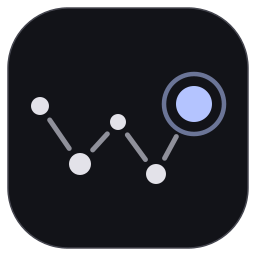</p>

<h1 align="center">Asterism</h1>

<p align="center">
  <b>A quiet, complete desktop shell for niri and Hyprland, written in pure Rust.</b><br>
  Bar · launcher · dock · control centre · notifications · lock screen · widgets · wallpapers · settings — in one ~30 MB program.
</p>

<p align="center">
  
</p>

Asterism draws everything a Wayland desktop needs around your windows, in one consistent look
whose colours grow from your wallpaper. It talks to the compositor directly, renders on the CPU
with tiny-skia, and links no GTK, Qt or QML.

| | |
|---|---|
| **Compositors** | niri, and Hyprland (both the Lua config of 0.55+ and older hyprlang) |
| **Footprint** | ~27 MB of memory, ~0.3 % of one core at rest |
| **Dependencies** | one system library (libxkbcommon); everything else optional, found at run time |
| **Configuration** | a Settings app, or one commented TOML file, reloaded live |
| **Licence** | GPL-3.0-or-later |

## Contents

- [Highlights](#highlights) · [Look and feel](#look-and-feel) · [The bar and its menus](#the-bar-and-its-menus)
- [Control centre](#control-centre) · [Your day](#your-day) · [Launcher](#launcher) · [Dock](#dock) · [Window overview](#window-overview)
- [The desktop](#the-desktop): wallpapers, widgets, desktop menu, app colours, night light
- [Pets](#pets) · [Notifications and on-screen cards](#notifications-and-on-screen-cards)
- [Settings](#settings) · [Dashboard](#dashboard) · [Clipboard and shortcuts](#clipboard-and-shortcuts) · [Timers and weather](#timers-and-weather)
- [Security and devices](#security-and-devices) · [Power](#power) · [Screenshots, recording and text capture](#screenshots-recording-and-text-capture)
- [Privacy](#privacy) · [Performance](#performance)
- [Requirements](#requirements) · [Installation](#installation) · [Keybindings](#keybindings) · [Configuration](#configuration) · [Command reference](#command-reference)
- [Troubleshooting and known limits](#troubleshooting-and-known-limits) · [Development](#development) · [Credits and licence](#credits-and-licence)

## Highlights

| | |
|---|---|
| 🎨 **Colour from your wallpaper** | A Material 3 scheme grown from each new wallpaper, for the bar, menus, widgets and, if you like, your terminal and GTK apps; optional frosted glass |
| 🧱 **A bar you arrange** | Five styles, workspaces as dots, numbers or kanji, and every item movable by dragging it along the bar |
| 🧭 **Everything in reach** | App launcher with maths, emoji and SSH; a dock; window overview; clipboard history; keyboard-shortcut sheet |
| 🗓️ **Your day** | Timers, a to-do list and notes, kept as plain Markdown files |
| 🖼️ **A living desktop** | A searchable wallpaper picker, animated transitions, video and GIF wallpapers, widgets you arrange by hand, a music visualizer |
| 🔒 **The serious parts** | Lock screen (with fingerprint), polkit agent, Wi-Fi password prompts, Bluetooth pairing, notification daemon |
| 🛡️ **Know what's watching** | A privacy pill while an app uses your microphone, a camera or your screen |
| 🐈 **A little life** | Optional pets (cats, foxes, birds, pandas, tigers, lions) that live on the screen and react to you |
| ⚙️ **Scriptable** | Every panel and action through `asterism msg …` |

## Look and feel

Asterism's look is called *hairline*: flat surfaces edged with a 1-pixel outline, cards with a
soft shadow, and the accent colour used sparingly to mark state.

**Colour comes from the wallpaper.** The scheme is grown from the colour that stands out most in
your picture and regrown at every change; `[colors] accent` picks it yourself. Bar icons and
widgets can be *tinted* (default), *accent*, *colourful* or *plain*.

<p align="center"></p>

**Five bar styles**: `line` (default), `floating`, `islands`, `transparent`, and `frame`, which
runs a thin frame round the screen and hangs menus from the bar like drawers. The `transparent`
bar reads the wallpaper under each item: words and icons turn dark where the picture is light.

<p align="center"></p>

<p align="center"></p>

**Workspaces** as an *asterism* (the default: a dot each, busy ones joined by a line, the current
one ringed), as numbers, or as kanji with the current one marked by a *bōten* (傍点), the
emphasis dot of Japanese type.

<p align="center">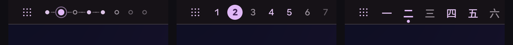</p>

**Frosted glass** is opt-in: the compositor blurs what's behind the dock, the app grid, the
overview, the wallpaper picker, the control centre, notifications and widgets (Settings → Look →
Frosted glass, or `[blur]`). It needs ext-background-effect (niri 26 has it); on Hyprland use
layer rules such as `layerrule = blur, asterism-dock`.

## The bar and its menus

| Module | Shows | Click | Right click | Scroll |
|---|---|---|---|---|
| `launcher` | An apps button | Launcher | | |
| `pages` | Workspaces (at least `pages` of them, 8 by default); hover one for a card of its windows | Go there | Window overview | Next / previous |
| `clock` | Time and date | Calendar | | |
| `day` | A checklist with how many tasks are left | [Your day](#your-day) | | |
| `weather` | Current weather | Forecast | | |
| `media` | What's playing (MPRIS) | Player menu | Play / pause | |
| `resources` | CPU, memory and temperature rings, network speed | Dashboard, traffic | | |
| `tray` | Background apps (StatusNotifierItem) | Activate | App menu | Scroll the app |
| `tools` | Screenshot and recording, colour picker, clipboard, microphone, stay awake | Menu, run or toggle | | |
| `status` | Timers, notifications, keyboard layout, network, Bluetooth, volume, battery, control centre, settings, session | Their menus | Mute, Bluetooth, do not disturb | Volume |

**The privacy pill.** While an app uses the microphone, a camera or the screen, a small pill
appears before the status icons with one icon for each. Hover it for the apps; click it to see
them, mute the microphone, or (on niri) stop a screen share; right-click mutes the microphone.
Settings → Bar → Privacy chooses what it watches.

<p align="center">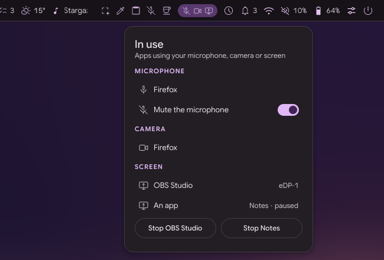</p>

**Arranging the bar.** Drag an item with the middle button to move it anywhere on the bar, or
let go of it well off the bar to take it off. For plain left drags, turn on arrange mode
(Settings → Bar → Arrange, or `asterism msg bar arrange`) and press **Done** when finished.
Settings → Bar → Arrangement does the same with buttons, and brings back items you took off.

The top-right corner of the screen opens the control centre; the top-left corner opens your day.

<p align="center"></p>
<p align="center"></p>

**Menus:** calendar with the moon's phase; music (cover, seek bar, other players); sound
(volume, brightness, output device, microphone, per-app volume); network (Wi-Fi, saved VPNs);
Bluetooth (devices, battery levels, pairing); battery and power profiles; timers; weather;
screenshots; session (the last three choices ask twice); traffic; keyboard layouts;
notifications; privacy; and every tray app's own menu.

Every menu works from the keyboard: arrows, Tab, Home/End and Page Up/Down move, Enter
activates, ← → nudge sliders and change months, Esc closes.

## Control centre

The top-right corner, Mod+A, or `asterism msg control` (pictured at the top of this page):
quick tiles (Wi-Fi, VPN, Bluetooth, do not disturb, stay awake, microphone, power profile,
night light, wallpaper, settings), volume and brightness, now playing, notifications grouped by
app, and lock, sleep, log out, restart and shut down.

## Your day

Its button beside the clock, the top-left corner, Mod+Shift+D, or `asterism msg day`.

<p align="center"></p>

- **Timers:** a focus session or a 5, 10 or 25-minute countdown.
- **To do:** type a task and press Enter; click to tick it, × to remove it.
- **Notes:** click and write; Tab switches between the task field and the notes.

Both are plain files you can edit anywhere: `~/Documents/Asterism/todo.md` (a Markdown
checklist) and `notes.md`, saved as you type and read again each time the panel opens. Move them
with `[day] folder`.

## Launcher

The apps button, Mod+Space, or `asterism msg launcher`: your apps in a paged grid, with search.

<p align="center"></p>

Search matches names, initials (`vsc` → Visual Studio Code), keywords and descriptions, with the
apps you use most first. It also understands:

| Type | Result |
|---|---|
| `2*pi`, `= sqrt(2)` | The answer; Enter copies it |
| `> command` | Runs the command |
| `>ssh name` | Hosts from `~/.ssh/config`; Enter connects in your terminal |
| `:heart` | Emoji by name; Enter copies one |
| `? question` | A web search |

Apps start in their own systemd scope, so restarting the shell never takes them down.

## Dock

Your apps on a card at an edge of the screen (the foot by default). It stays hidden until the
pointer touches that edge, Mod+D, or `asterism msg dock`, and slides away when you leave.

<p align="center">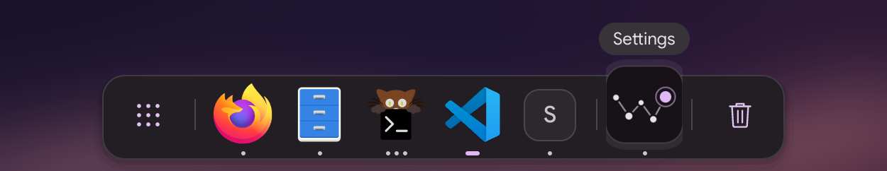</p>

- **Pinned apps** keep their places; **open apps** follow, with a dot per window.
- **Click** to go to an app (again for its next window) or start it; **middle-click** starts
  another; **right-click** lists its windows and offers pin, unpin and close.
- **Drag** to reorder, to pin an open app, or off the dock to unpin.
- The **apps button** opens the launcher; the **trash** opens or empties from its menu.

Settings → Dock has its edge, hiding, icon size, magnifying, corners, background and the pinned
apps.

## Window overview

Mod+O, `asterism msg overview`, or a right-click on the workspaces: every workspace as a card
with a map of its windows.

<p align="center"></p>

Click a window to focus it, drag it onto another card to move it, middle-click to close it, or
type to find one. Resting the pointer on a workspace in the bar shows its card alone.

## The desktop

### Wallpapers

Your picture on every output (cover, whole or stretched), or, without one, a quiet gradient in
the scheme's colours. The picker opens with Mod+W, the control centre's Wallpaper tile, or
`asterism msg wallpaper`.

<p align="center"></p>

- **Pick** one with a click, or the arrows and Enter.
- **Find** one by typing part of its name; the chips show all, still or moving ones.
- **Change folder** with the button under the title: your desktop's folder dialog, recent
  folders, or the ones around this one.
- **Shuffle**, Ctrl+R or Mod+Shift+W picks one at random.
- **Along the foot:** how it fills the screen, how often it changes by itself, whether moving
  ones play, and the rest of the wallpaper settings.

**Every change animates**, a different way each time (fade, wipe, circle, blinds, ink, pixels or
slide), or the one you set in `[wallpaper] transition`.

<p align="center"></p>

**Live wallpapers:** a video (mp4, webm, mkv… through `ffmpeg`) or an animated GIF works like any
picture. It pauses while covered by windows, on battery (unless `live_battery = true`), while
locked, and when you're away. Sharpness (Settings → Wallpaper, 75 % by default) trades detail
for CPU.

### Widgets

Small cards on the wallpaper, under your windows: a clock, the weather, a month calendar, what's
playing (with synced lyrics), a music visualizer, the machine's load, a photo frame and a sticky
note.

<p align="center"></p>

**To arrange them**, right-click the desktop and choose *Arrange widgets* (or Settings → Desktop,
or `asterism msg widgets edit`). Drag a widget to move it, drag its sides or corners to resize
it, × to remove it, the strip at the top to add more, and Done to finish.

<p align="center">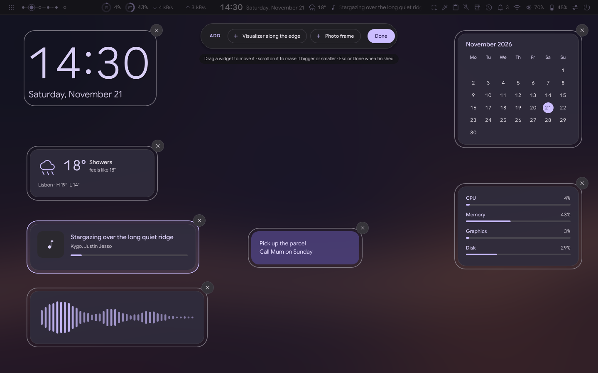</p>

Their background can be anything from solid to see-through (`[widgets] opacity`), with an
outline and frosted glass if you like.

### Desktop menu

Right-click the wallpaper for *Arrange widgets*, *Change wallpaper*, *Another wallpaper* and
*Settings*; right-click a widget for its own items too.

### Colours for your apps

With `[colors] apps` (or Settings → Look), the scheme is written for **kitty**, **foot**,
**Alacritty** and **GTK** as files of their own. Include the file once (Settings shows the line)
and the app follows every wallpaper change; your own configs are never edited.

### Night light

Warmer colours through the compositor's gamma control: a toggle in the control centre, or
`[night_light] mode = "schedule"` from sunset to sunrise (or set times).

## Pets

Optional companions that live on the screen above your windows, as many as you like: a **cat**,
**fox**, **bird**, **panda**, **tiger** or **lion**, each in real coats or the wallpaper's
colours.

<p align="center">
  
  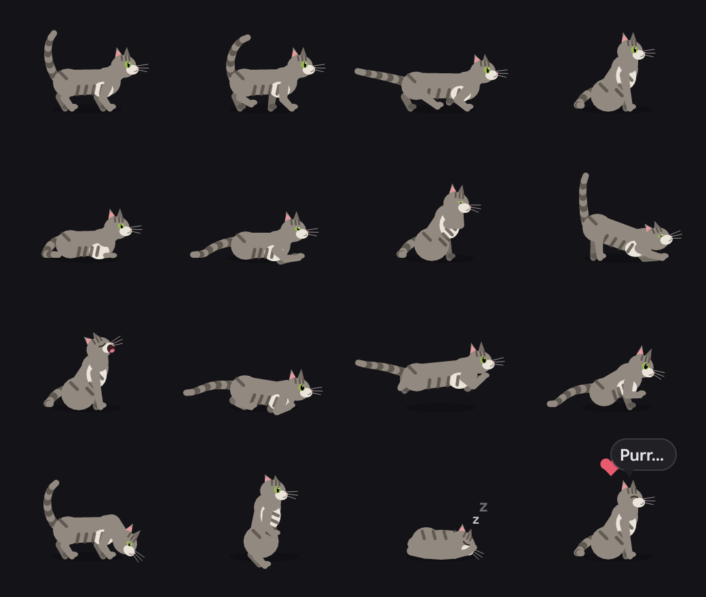
  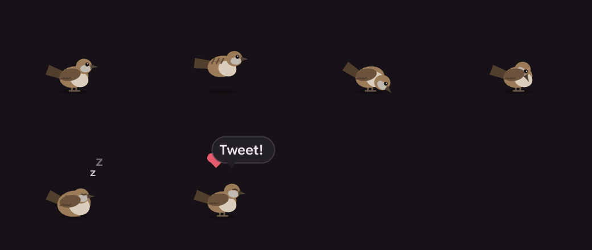
  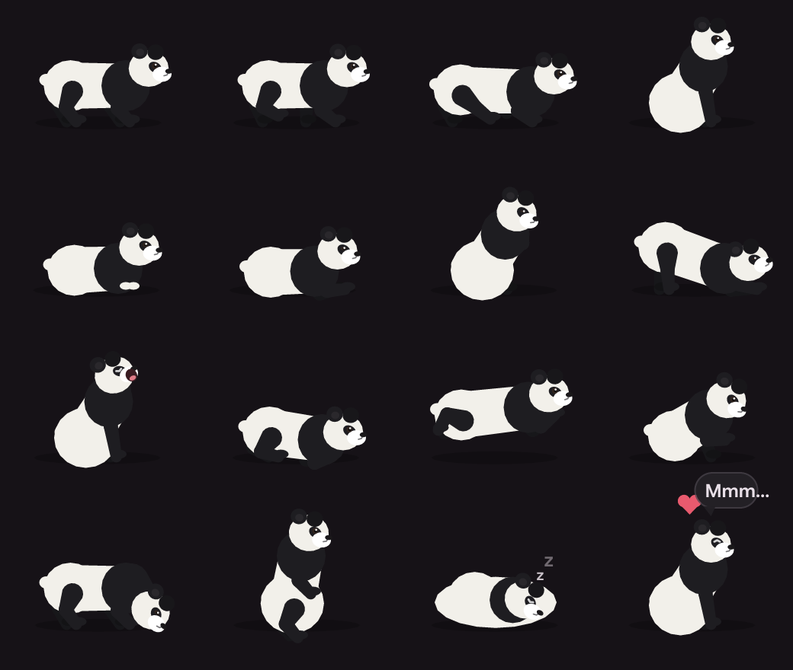
  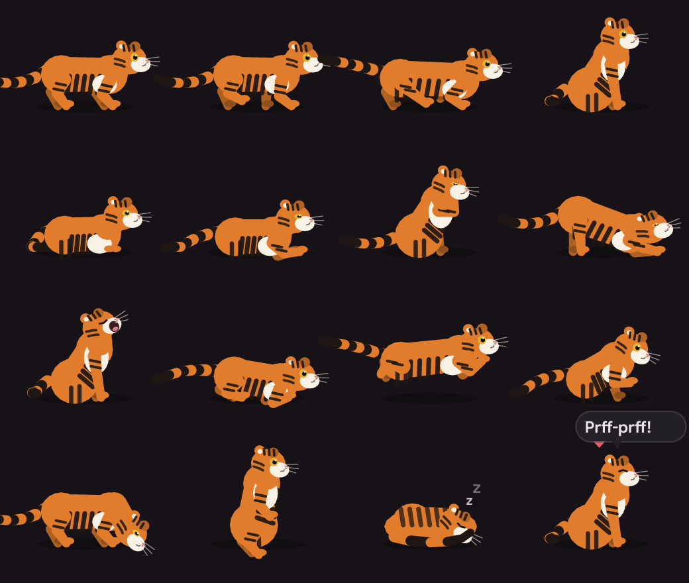
  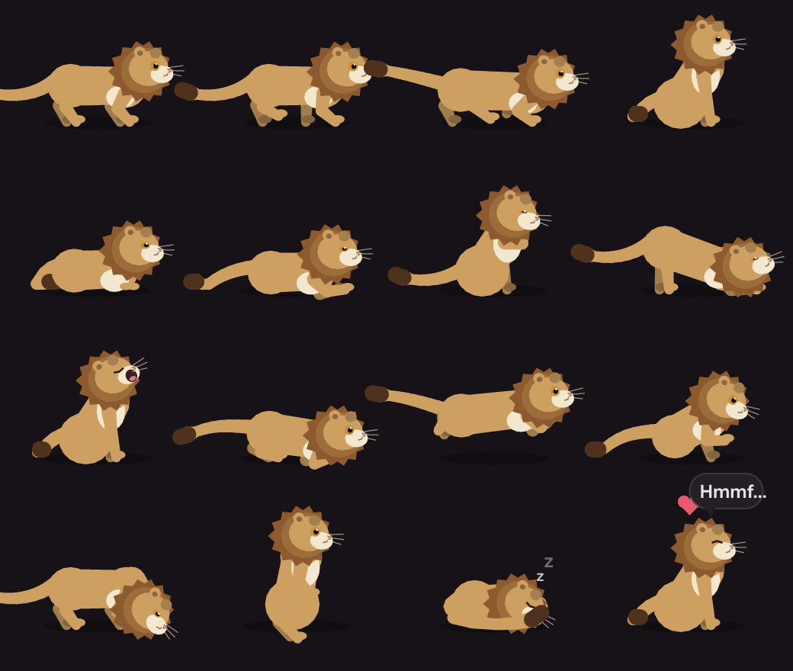
</p>

They nap when tired, ask to be fed, chase the pointer and pounce, sway to music, sleep while
you're away, and keep each other company. **Click** one to stroke it, **drag** it to pick it up,
and **right-click** it to feed it, play with a ball or yarn, give it a bed, or put it away. They
speak now and then with synthesized voices (off in do-not-disturb and while locked).

Choose them in Settings → Pets, by picture, or with `[pet] pets = ["cat:ginger", "panda"]`.

## Notifications and on-screen cards

Asterism is the **notification daemon** unless another one is running. Pop-ups show pictures and
action buttons; the centre (the bell, Mod+N) has *do not disturb* and *clear all*; per-app rules
can keep an app quiet or drop its notifications.

<p align="center"></p>

Also: a card when the song changes, a preview of a workspace under the pointer, and a small level
for volume, brightness and keyboard-layout changes from any source.

<p align="center"></p>

## Settings

The control centre's Settings tile, the gear in the bar, or `asterism msg settings`. An ordinary
window with pages for Look, Bar, Wallpaper, Desktop, Dock, Pets, Night light, Power,
Notifications, Weather and Timers. Type anywhere to search every page. Each change is written to
`config.toml` at once, keeping your comments.

<p align="center"></p>

Its app id is `asterism-settings`, for window rules (to open it floating, for instance).

## Dashboard

Click the CPU or memory ring, or `asterism msg dashboard`: graphs of processor, memory, graphics
and network, how full each disk is, and what's running, with *End* for your own processes.

<p align="center"></p>

## Clipboard and shortcuts

**Clipboard history** (the tools' clipboard button, Mod+Ctrl+V, or `asterism msg clipboard`):
text and pictures, newest first; type to search, Enter puts one back, Delete forgets it. It's
kept in memory only, and anything marked secret by a password manager is never read.

<p align="center">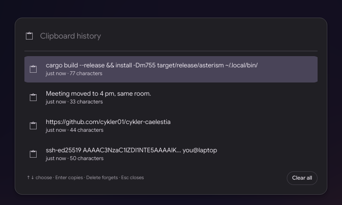</p>

**Keyboard shortcuts** (Mod+Shift+/ or `asterism msg shortcuts`): your compositor's own bindings
as a sheet of keycaps; type to narrow it down.

<p align="center"></p>

## Timers and weather

**Timers:** a countdown, focus rounds (25 minutes on, 5 off, set in `[timers]`), and a stopwatch
with laps. A running timer shows as a ring in the bar and notifies you when it's done.

**Weather** comes from Open-Meteo for `[weather] city` (or your time zone's city): the
temperature in the bar, and the details and five days ahead in its menu.

## Security and devices

<p align="center"></p>

- **Lock screen:** on Mod+Alt+L, when logind asks, before sleep, and after a while away
  (Settings → Power). It runs as its own process, checks your password with the system's `unix_chkpwd`, and
  takes a fingerprint through fprintd. Locked out? See [Troubleshooting](#troubleshooting-and-known-limits).
- **Polkit:** when an app needs administrator rights, the password is asked on a card and
  checked by polkit's own helper.
- **Wi-Fi:** a secured network asks for its password on a card; saved VPNs get a switch.
- **Bluetooth:** the menu scans for nearby devices; pairing questions come up on a card, and
  paired devices show their battery.

## Power

Settings → Power says what happens while you're away, with its own times plugged in and on
battery: the screens dim (a laptop's backlight goes down; a monitor with no backlight gets a
dark veil), then lock, turn off, and the machine sleeps. Any input brings the screens back; a
video playing or Stay awake holds it all off, and sleep waits while music plays. Once locked,
the screens go off after a minute. The lid (on battery, plugged in, with another screen) and the
power button can be left to the system or given their own action: sleep, lock, the session
menu, shut down or nothing. For the button, bind its key to `asterism msg power button`
(niri: `XF86PowerOff allow-when-locked=true { spawn "asterism" "msg" "power" "button"; }`).

## Screenshots, recording and text capture

The tools' screenshot button: a **screenshot** of a region, the screen or a window; a
**recording**, with or without sound (needs `wf-recorder`; click the red dot in the bar to
stop); or **text from a region**, recognised and copied (needs `slurp`, `grim` and
`tesseract`).

## Privacy

Only these leave your machine, and only when you use the feature:

| What | Sent to | Contains |
|---|---|---|
| Weather | [Open-Meteo](https://open-meteo.com) | The city you set (or your time zone's), then its coordinates |
| Synced lyrics | [LRCLIB](https://lrclib.net) | The playing song's artist, title, album and length (`[widgets] lyrics = false` stops it) |
| Album covers | The address the player gives | Whatever the player points at |
| `?` searches in the launcher | Your search engine (`[launcher] search`) | Your question |

Nothing else is sent anywhere. Clipboard history never touches the disk, and passwords are wiped
from memory after use and never logged.

## Performance

Measured on a 1920×1200 laptop:

| | |
|---|---|
| Memory | ~27 MB resident, ~19 MB of it the program and its fonts (shared) |
| CPU at rest | ~0.3 % of one core |
| Pets | about 0.5 % of a core for each one moving, much less sitting or asleep |
| Video wallpaper | a 1080p video at 30 fps: about ⅓ of a core in `ffmpeg` at 75 % sharpness, ⅔ at 100 %; nothing while paused |

## Requirements

**Compositor:** niri, or Hyprland (Lua config or hyprlang; Asterism detects which).

**To build:** Rust 1.88 or newer. The only system library linked is **libxkbcommon**.

**At run time**, all optional; features appear when their tools are found:

| For | Needs |
|---|---|
| Sound, per-app volume | `pactl` (PipeWire's pulse server or PulseAudio) |
| Network, VPN, battery, power profiles | NetworkManager, UPower, power-profiles-daemon |
| Bluetooth and pairing | BlueZ |
| Lock screen · fingerprint | `unix_chkpwd` (Linux-PAM) · fprintd |
| Weather, lyrics, album covers | `curl` |
| Copying from the launcher | `wl-copy` |
| Music visualizer · pet sounds | `parec` or `pw-record` · `pw-play` or `paplay` |
| Recording · Hyprland screenshots · text capture | `wf-recorder` · `grim`, `slurp` · plus `tesseract` |
| Kanji workspaces · emoji | a CJK font · a colour emoji font |
| Video wallpapers | `ffmpeg` |
| The folder dialog in the wallpaper picker | xdg-desktop-portal with a file chooser |
| Naming apps in the privacy pill | `pw-dump` (PipeWire) |

## Installation

```sh
git clone https://github.com/sanjay-np/asterism.git && cd asterism
cargo build --release
install -Dm755 target/release/asterism ~/.local/bin/asterism
mkdir -p ~/.config/asterism && cp config.example.toml ~/.config/asterism/config.toml
# Optional: Settings in your app launcher, with its icon
install -Dm644 contrib/asterism-settings.desktop ~/.local/share/applications/asterism-settings.desktop
install -Dm644 assets/logo/asterism.svg ~/.local/share/icons/hicolor/scalable/apps/asterism.svg
```

**Start it with your session.** niri (use the full path; niri may not have `~/.local/bin` on its
`PATH`):

```kdl
spawn-at-startup "/home/you/.local/bin/asterism"
```

Hyprland: `exec-once = asterism` (hyprlang), or `hl.exec_cmd("asterism")` in a
`hyprland.start` handler (Lua config). Or with systemd, when your session reaches
`graphical-session.target`:

```sh
install -Dm644 contrib/asterism.service ~/.config/systemd/user/asterism.service
systemctl --user enable --now asterism.service
```

**Updating:** run the `install` line again, then `pkill -x asterism; setsid -f
~/.local/bin/asterism`. Apps you started and an open lock screen keep running.

**Coming from another shell:** stop it starting, move your keybindings to `asterism msg …`, and
if the lid switch asked the old shell to lock, make it plain `systemctl suspend`: Asterism locks
before any sleep by itself.

## Keybindings

**niri** (inside `binds { }`; these keys are free in niri's default config):

```kdl
Mod+Space hotkey-overlay-title="Apps" { spawn "asterism" "msg" "launcher"; }
Mod+O hotkey-overlay-title="Window overview" { spawn "asterism" "msg" "overview"; }
Mod+A hotkey-overlay-title="Control centre" { spawn "asterism" "msg" "control"; }
Mod+Shift+D hotkey-overlay-title="Your day" { spawn "asterism" "msg" "day"; }
Mod+D hotkey-overlay-title="Dock" { spawn "asterism" "msg" "dock"; }
Mod+N hotkey-overlay-title="Notifications" { spawn "asterism" "msg" "notifications"; }
Mod+Ctrl+V hotkey-overlay-title="Clipboard history" { spawn "asterism" "msg" "clipboard"; }
Mod+W hotkey-overlay-title="Change the wallpaper" { spawn "asterism" "msg" "wallpaper"; }
Mod+Shift+W hotkey-overlay-title="A random wallpaper" { spawn "asterism" "msg" "wallpaper" "random"; }
Mod+Shift+Slash hotkey-overlay-title="Keyboard shortcuts" { spawn "asterism" "msg" "shortcuts"; }
Mod+Alt+L hotkey-overlay-title="Lock the screen" { spawn "asterism" "msg" "lock"; }
Mod+Shift+Escape { spawn "asterism" "msg" "menu" "session"; }
```

Volume, brightness and media keys can stay on `wpctl`, `brightnessctl` and `playerctl`: Asterism
shows the level for changes from any source. Or route them through it, for example
`XF86AudioRaiseVolume allow-when-locked=true { spawn "asterism" "msg" "volume" "up"; }` (see the
[Command reference](#command-reference) for the rest).

**Hyprland**: the same commands through `exec`, e.g. `bind = SUPER, SPACE, exec, asterism msg launcher`.

## Configuration

Everything lives in `~/.config/asterism/config.toml`, and the Settings app writes there too.
[config.example.toml](config.example.toml) documents every option. Changes apply within two
seconds, with no restart.

| Section | Covers |
|---|---|
| *(top level)* | `style`, `size`, `position`, `page_style`, `pages`, `font`, `icons`, `hot_corner`, `outputs`, `song_popup` |
| `[clock]` · `[layout]` | Clock format; which modules sit left, centre and right |
| `[commands]` | Commands for settings, lock, suspend, log out, reboot, power off |
| `[notifications]` · `[notifications.apps]` | Daemon, timeouts, battery warnings; per-app rules |
| `[wallpaper]` | Picture, video or GIF, fit, folder, rotation, transitions, live playback |
| `[privacy]` | What the privacy pill shows: `microphone`, `camera`, `screen` |
| `[colors]` | Accent, role overrides, icon and widget tinting, app colour files |
| `[launcher]` · `[weather]` · `[timers]` | Terminal and search engine; place and units; focus lengths |
| `[lock]` · `[power]` | Idle minutes, before sleep, fingerprint; dim, screens off, sleep, the lid and the power button |
| `[night_light]` | Schedule and temperature |
| `[widgets]` · `[day]` · `[pet]` | Desktop widgets and their look; the to-do folder; the pets |
| `[dock]` | Pinned apps, edge, hiding, size and look |
| `[blur]` | Frosted glass behind the dock, launcher, overview, wallpaper picker, control centre and notifications |

The settings you're most likely to change first:

```toml
style = "line"            # line, frame, floating, islands or transparent
page_style = "dots"       # dots, numbers or kanji

[layout]
left = ["launcher", "pages"]
center = ["resources", "clock", "weather", "media"]
right = ["tools", "tray", "status"]

[wallpaper]
image = "~/Pictures/Wallpapers/sea.jpg"   # the colours come from it
interval = 0                              # minutes between automatic changes; 0 = never

[lock]
idle = 10                 # minutes without input before locking; 0 = never

[widgets]
show = ["clock", "weather", "media"]

[dock]
pinned = ["firefox", "kitty", "org.gnome.Nautilus"]   # desktop file ids, in order
```

## Command reference

`asterism msg COMMAND` drives the running shell, for keybindings and scripts;
`asterism msg help` prints this list.

| Command | Does |
|---|---|
| `launcher`, `control`, `day`, `overview`, `dashboard`, `settings`, `clipboard`, `shortcuts` `[open\|close]` | Toggle (or open / close) that panel |
| `menu NAME` | Toggle a bar menu: `calendar`, `media`, `sound`, `network`, `bluetooth`, `power`, `session`, `machine`, `traffic`, `keyboard`, `notifications`, `privacy` |
| `notifications [clear]` · `dnd` | Notification centre, or clear it · toggle do not disturb |
| `volume up\|down [PERCENT]` · `volume mute` · `mic mute` | Change volume (and show it) · mute · mute the microphone |
| `brightness up\|down [PERCENT]` · `osd volume\|brightness` | Change brightness · show a level without changing it |
| `media play-pause\|next\|previous` | Control the player the bar follows |
| `wallpaper [open\|close]` · `wallpaper next\|previous\|random` · `wallpaper set PATH` | The picker · step · set a picture |
| `widgets [edit\|done]` | Arrange the desktop's widgets, or finish |
| `dock [show\|hide]` | Bring the dock up, put it away, or toggle it |
| `bar arrange [on\|off]` | Arrange mode for the bar |
| `night-light [on\|off]` · `awake` | Night light · keep the screen awake |
| `lock` | Lock the screen |
| `power button` | What the power button does (`[power] button`) |
| `screenshot [region\|screen\|window]` · `screen-text` · `record [audio]` | Capture · copy text from a region · start or stop recording |
| `timer MINUTES` · `timer pause\|cancel` · `focus` · `stopwatch [lap\|reset]` | Timers |
| `pet feed\|play\|yarn\|bed\|nobed` · `pet add [ANIMAL[:COAT]]` · `pet [N] next\|away` | Pets and their things |
| `reload` · `ping` | Re-read the config · check the shell is running |

`asterism unlock` releases the lock screen from a console (the recovery path).

## Troubleshooting and known limits

**Locked out?** Switch to a console (Ctrl+Alt+F3), log in, run `asterism unlock`, and switch
back.

**It won't start, saying it's already running.** One shell per display; `pkill -x asterism`
stops the other.

**No notification pop-ups.** Another daemon (mako, swaync, dunst, another shell) owns
notifications; stop it and restart Asterism.

**Something is missing from the bar.** `RUST_LOG=debug asterism` shows which services and tools
were found.

**A live wallpaper doesn't move.** It pauses on battery (unless `live_battery = true`), while
locked, and when you're away; videos need `ffmpeg`.

**A video wallpaper looks soft.** Raise Settings → Wallpaper → Sharpness to 100 %.

**"Choose a folder…" does nothing.** Install an xdg-desktop-portal backend with a file chooser
(gtk, gnome or kde), or set `[wallpaper] directory`.

**Blur doesn't show.** Your compositor needs ext-background-effect (niri 26+); on Hyprland use
layer rules. Opaque widgets hide it: lower `[widgets] opacity`.

**Known limits:**
- No 802.1X (enterprise) Wi-Fi; notification bodies are plain text, with no inline reply.
- The overview shows maps of windows, not live thumbnails.
- Clipboard history is empty after a restart, by design.
- The wallpaper picker lists one folder at a time, and one picture covers all outputs.
- Live wallpapers are drawn by the processor, so a video costs more than in a GPU player.
- On niri, workspaces beyond those in use all lead to niri's one empty workspace.
- The privacy pill sees cameras opened by your own processes; on Hyprland it can't stop a share.
- Pets see the pointer only over the shell's own surfaces.
- The dock lives on one output.
- Hyprland is tested less in daily use than niri.

## Development

```sh
cargo run --release                       # run it
cargo test --release                      # 119 tests
cargo clippy --release
cargo run --example fixtures -- 60        # a fake music player and tray app for a minute
```

**Snapshot mode** renders the real UI with live data and no compositor, which is how every
picture here was made: `asterism --snapshot out.png` for the bar, with `--menu NAME`,
`--panel NAME` (`wallpaper` for the whole desktop) and `--demo` for made-up workspaces, networks
and processes you can share.

Architecture, conventions and the code map are in [AGENTS.md](AGENTS.md).

## Credits and licence

Asterism began as a rewrite of the top bar of [ETEA Shell](https://github.com/SDcold/etea-shell)
by SDcold, and its layout and much of its feature list still owe a lot to it. The frame style and
several features took cues from [cykler-caelestia](https://github.com/cykler01/cykler-caelestia).

Asterism is free software under the **GNU General Public License v3.0 or later**, the same as
ETEA (see `LICENSE`).

Bundled assets keep their own licences: Google Sans Flex and Poppins (SIL Open Font License,
`assets/fonts/`); Material outline icons and Material Symbols (Apache 2.0) and Phosphor (MIT),
each with its licence in `assets/icons/`; emoji names from Unicode's emoji-test.txt (Unicode
License v3, `assets/emoji-LICENSE.txt`).

Weather data by [Open-Meteo](https://open-meteo.com); lyrics by [LRCLIB](https://lrclib.net).
The wallpapers in these screenshots are abstract gradients made for this README.
