<h1 align="center">Asterism</h1>

<p align="center">
  <b>A quiet, complete desktop shell for niri and Hyprland, written in pure Rust.</b><br>
  Bar · launcher · control centre · notifications · lock screen · widgets · wallpapers · settings — in one ~30 MB program.
</p>

<p align="center">
  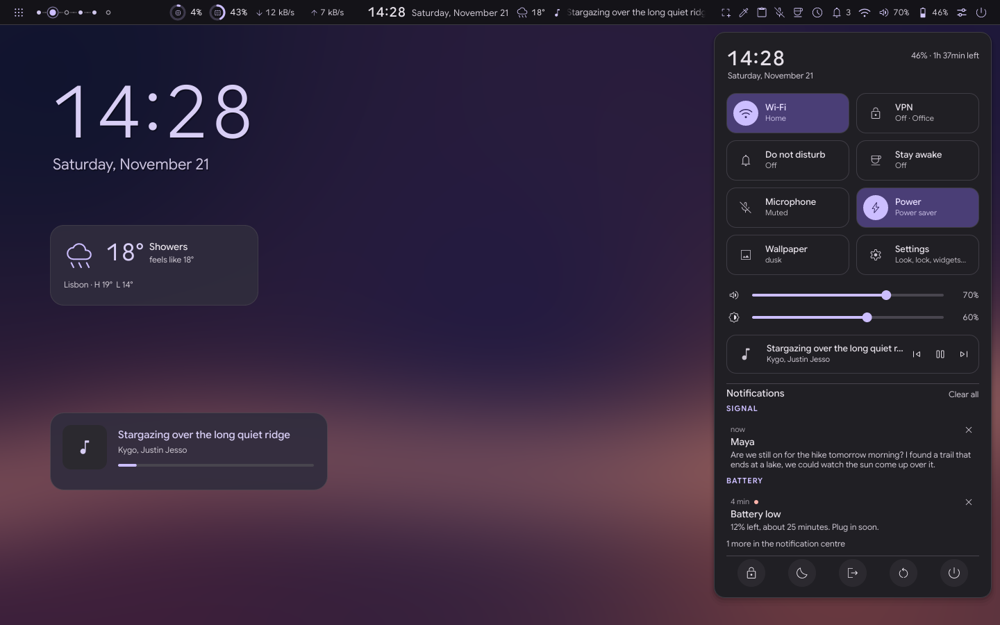
</p>

Asterism draws everything a Wayland desktop needs around your windows, in one consistent look
whose colours grow from your wallpaper. It talks to the compositor directly (layer-shell, xdg
popups, session lock, data control, gamma control), renders on the CPU with tiny-skia, and links
no GTK, Qt or QML.

| | |
|---|---|
| **Compositors** | niri, and Hyprland (both the Lua config of 0.55+ and older hyprlang) |
| **Footprint** | ~27 MB of memory with the wallpaper, dock and pets up, ~0.3 % of one core at rest |
| **Dependencies** | one system library (libxkbcommon); everything else optional, found at run time |
| **Configuration** | a Settings app, or one commented TOML file, reloaded live |
| **Licence** | GPL-3.0-or-later |

## Contents

- [Highlights](#highlights)
- [Look and feel](#look-and-feel)
- [The bar and its menus](#the-bar-and-its-menus)
- [Control centre](#control-centre) · [Your day](#your-day) · [Launcher](#launcher) · [Dock](#dock) · [Window overview](#window-overview)
- [The desktop](#the-desktop): wallpapers, widgets, desktop menu, app colours, night light
- [Pets](#pets)
- [Notifications and on-screen cards](#notifications-and-on-screen-cards)
- [Settings](#settings) · [Dashboard](#dashboard) · [Clipboard and shortcuts](#clipboard-and-shortcuts) · [Timers and weather](#timers-and-weather)
- [Security and devices](#security-and-devices): lock screen, polkit, Wi-Fi, Bluetooth
- [Screenshots, recording and text capture](#screenshots-recording-and-text-capture)
- [Privacy](#privacy) · [Performance](#performance)
- [Requirements](#requirements) · [Installation](#installation) · [Keybindings](#keybindings) · [Configuration](#configuration) · [Command reference](#command-reference)
- [Troubleshooting and known limits](#troubleshooting-and-known-limits) · [Development](#development) · [Credits and licence](#credits-and-licence)

## Highlights

| | |
|---|---|
| 🎨 **Colour from your wallpaper** | A Material 3 scheme grown from each new wallpaper, applied to the bar, menus, widgets — and, if you like, your terminal and GTK apps; frosted-glass blur behind panels, the dock and widgets |
| 🧭 **Everything in reach** | App launcher with maths, emoji and SSH; a dock that hides until you want it; window overview; workspace previews on hover; clipboard history; keyboard-shortcut sheet |
| 🗓️ **Your day** | Timers, a to-do list and notes, a button of its own in the bar, kept as plain Markdown files |
| 🖼️ **A living desktop** | Wallpaper changer with animated transitions, live video and GIF wallpapers, desktop widgets you arrange by hand (solid, see-through or frosted), a music visualizer |
| 🔒 **The serious parts** | Lock screen (with fingerprint), polkit agent, Wi-Fi password prompts, Bluetooth pairing, notification daemon |
| 🐈 **A little life** | Optional pets, as many as you like — cats, foxes, birds, pandas, tigers, lions — that live on the screen and react to you |
| ⚙️ **Scriptable** | Every panel and action through `asterism msg …`, for keybindings and scripts |

## Look and feel

Asterism's look is called *hairline*: flat surfaces edged with a 1-pixel outline, cards with a
soft shadow, and the accent colour used sparingly to mark state.

**Colour comes from the wallpaper.** The whole scheme is grown from the colour that stands out
most in your picture and regrown at every change. Set `[colors] accent` to choose it yourself.
Bar icons and widgets follow it too: *tinted* (default), *accent*, *colourful* or *plain*.

<p align="center">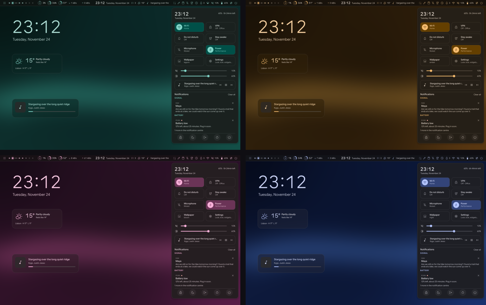</p>

**Five bar styles**: `line` (default), `floating`, `islands`, `transparent`, and `frame`, which
runs a thin frame round the whole screen and hangs menus from the bar like drawers.

<p align="center">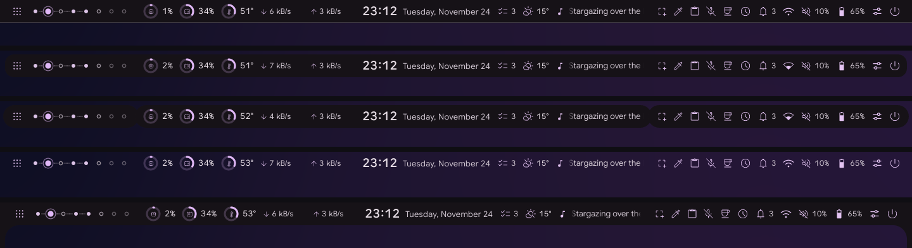</p>

<p align="center"></p>

**Three ways to show workspaces.** An *asterism* is a small pattern of stars, and that is the
default: a dot per workspace, busy ones joined by a line, the current one ringed. Or numbers. Or
kanji, the current one marked with a *bōten* (傍点), the emphasis dot of Japanese type.

<p align="center"></p>

Type is Google Sans Flex (bundled), icons are thin Material outlines (or rounded Material, or
Phosphor), and motion is kept quick.

**Frosted glass, if you like it.** The compositor can blur what's behind the dock, the app
grid, the overview, the wallpaper picker, the control centre, notifications (pop-ups and the
notification centre) and the desktop widgets. Each is a switch, all together in Settings → Look →
Frosted glass, or in the config:

```toml
[blur]
dock = true
launcher = true           # the app grid
overview = true
wallpapers = true         # the wallpaper picker
control = true            # the control centre
notifications = true      # pop-ups and the notification centre

[widgets]
blur = true
opacity = 30              # how solid their cards are, 0–100 %
```

Frosted cards are drawn see-through and without their shadow, and full-screen views dim the
screen less, so the blur shows. All are off by default. Blur needs a compositor that offers
ext-background-effect (niri 26 does); on Hyprland, layer rules do the same:
`layerrule = blur, asterism-dock` (and `asterism-launcher`, `asterism-overview`,
`asterism-wallpapers`, `asterism-control`, `asterism-notifications`, `asterism-desktop`). With
the `frame` style the control centre is joined to the frame, so it stays solid.

## The bar and its menus

| Module | Shows | Click | Right click | Scroll |
|---|---|---|---|---|
| `launcher` | An apps button | Launcher | | |
| `pages` | Workspaces; hover one for a card of its windows | Go there | Window overview | Next / previous |
| `clock` | Time and date | Calendar | | |
| `day` | A checklist, with how many tasks are left | [Your day](#your-day) | | |
| `weather` | Current weather | Forecast | | |
| `media` | What's playing (MPRIS) | Player menu | Play / pause | |
| `resources` | CPU, memory and temperature rings (the heat fills from 30 to 100 °C, warns past 85), network speed | Dashboard, traffic | | |
| `tray` | Background apps (StatusNotifierItem) | Activate | App menu | Scroll the app |
| `tools` | Screenshot and recording, colour picker, clipboard, microphone, stay awake | Menu, run or toggle | | |
| `status` | Timers, notifications, keyboard layout, network, Bluetooth, volume, battery, control centre, settings, session | Their menus | Mute, Bluetooth, do not disturb | Volume |

To change what sits where, use Settings → Bar → Arrangement. It shows the bar's left, middle and
right parts with their items in order. Click an item, then move it with **Earlier** and **Later**
(past the end of a part it moves on to the next part), click another part to send it there, or
**Take it off**. Items left out wait under **Not in the bar**: click one, then the part it goes
in. **Usual arrangement** puts everything back. Each change is written to `[layout]` and the bar
follows at once.

You can also drag items on the bar itself:

- **Middle-button drag**, any time: hold the middle button on an item and drag it. An accent mark
  shows where it will land, in any part. A middle click without moving still does what it did
  (a tray app's second action).
- **Arrange mode**: Settings → Bar → On the bar itself → Arrange, or `asterism msg bar arrange`.
  Every item sits on a faint tint and clicks don't open anything, so a plain left drag moves an
  item. **Done** at the right end of the bar (or the same command again) finishes.
- Let go of an item well off the bar to take it off. Put it back from Settings.

(Ctrl+drag isn't possible: Wayland tells a program which keys are held only while it has the
keyboard, and clicking the bar doesn't give it the keyboard.)

The top-right corner of the screen opens the control centre; the top-left corner opens your day.

<p align="center">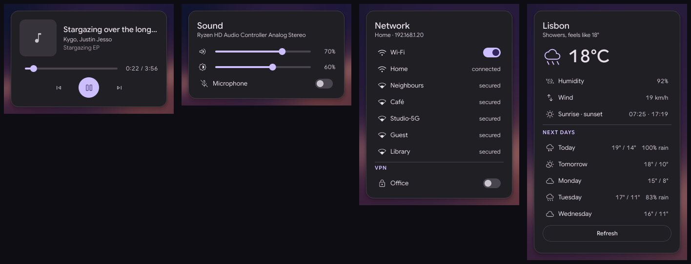</p>
<p align="center">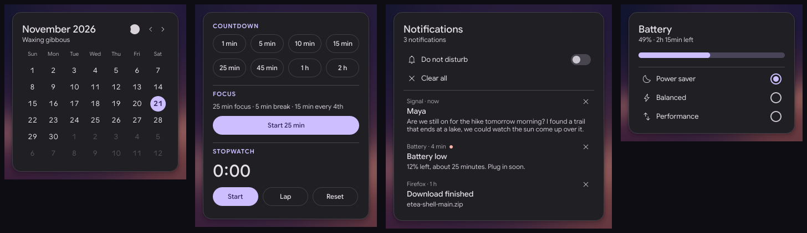</p>

**Menus:**
- calendar, with the moon's phase
- music: cover, seek bar, controls and other players
- sound: volume, brightness, output device, microphone, per-app volume
- network: Wi-Fi, nearby networks, saved VPNs
- Bluetooth: devices with battery levels, pairing
- battery and power profiles
- timers, weather, screenshots
- session: lock, sleep, log out, restart, shut down; the last three ask twice
- network traffic, keyboard layouts, notifications
- every tray app's own menu

Long menus scroll, and every menu works from the keyboard:

| Key | Action |
|---|---|
| ↑ ↓ · Tab · Shift+Tab | Move between items |
| Home · End · Page Up · Page Down | Jump to the ends, or by a page |
| Enter · Space | Activate |
| ← → | Nudge a slider (5 % or 5 s), change month, enter or leave a tray submenu |
| Esc | Close, or leave a submenu |

## Control centre

The power-icon button, the top-right corner, Mod+A, or `asterism msg control` (pictured at the
top of this page).

- **Quick tiles:** Wi-Fi, VPN, Bluetooth, do not disturb, stay awake, microphone, power profile,
  night light, wallpaper, settings.
- **Sliders:** volume and brightness.
- **Now playing**, and **notifications** grouped by app.
- **Session row:** lock, sleep, log out, restart, shut down.

Esc or a click beside the card closes it.

## Your day

A click on its own button in the bar (a checklist beside the clock, with how many tasks are
left), the top-left corner, Mod+Shift+D, or `asterism msg day`. It opens in the middle, under
the bar. The clock opens the calendar.

<p align="center">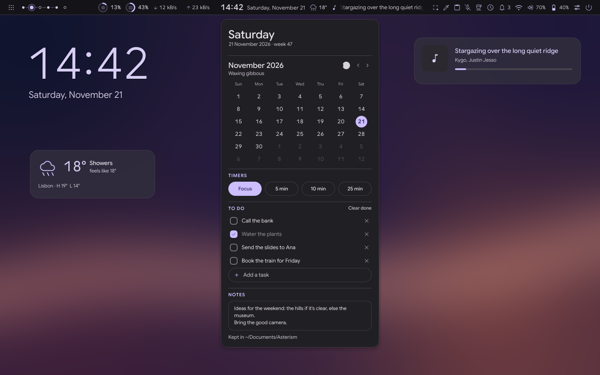</p>

- **Today**: the weekday, date and ISO week.
- **Timers**: start a focus session or a 5 / 10 / 25-minute countdown; running timers show here with Pause and Stop.
- **To do**: click *Add a task* (or just start typing) and press Enter. Click a task to tick it, × to remove it, *Clear done* to sweep ticked ones away.
- **Notes**: click and write. Tab moves between the task field and the notes; Esc leaves a field, then closes.

Both live as plain files you can edit anywhere: `~/Documents/Asterism/todo.md`, a Markdown
checklist (`- [ ] to do`, `- [x] done`), and `notes.md`. Changes are saved a second after you
stop typing. The files are read again each time the panel opens, so edits made elsewhere show
up. Move them with `[day] folder`.

## Launcher

The apps button, Mod+Space, or `asterism msg launcher`. A full-screen grid of your apps in
alphabetical order (so each keeps its place), paged with dots, and a search field.

<p align="center">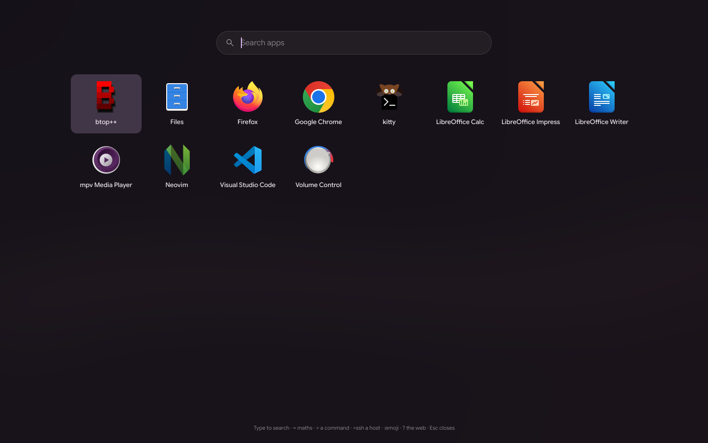</p>

Search matches names, initials (`vsc` → Visual Studio Code), keywords and descriptions, and puts
the apps you use most first. Apps start in their own systemd scope, so restarting the shell never
takes them down. It also understands:

| Type | Result |
|---|---|
| `2*pi`, `= sqrt(2)` | The answer; Enter copies it |
| `> command` | Runs the command |
| `>ssh name` | Hosts from `~/.ssh/config`; Enter connects in your terminal |
| `:heart` | Emoji by name; Enter copies one |
| `? question` | A web search |

Arrows move through the grid, Page Up/Down or the wheel turn pages, Enter opens, and Esc closes.
Backspace, Ctrl+W and Ctrl+U erase a letter, a word, or everything.

## Dock

Your apps on a card at the foot of the screen, or the top, left or right edge. It stays out of
sight, and takes no room from your windows, until the pointer touches the edge by it (or
`asterism msg dock`); it slides away a moment after the pointer leaves.

- **Pinned apps** keep their places; **open apps** join them after a thin line. A dot by an
  app for each of its windows (up to three, between the icon and the screen's edge); the
  focused app's dots are a pill in the accent.
- **Click** an app to go to it, again for its next window; if it isn't open, it starts.
  **Middle-click** starts another one. **Right-click** lists its windows, and offers a new
  window, pin or unpin, and close.
- **Drag** an icon along the dock to reorder; drop an open app among the pinned ones to pin it,
  or pull a pinned one off the dock, away from the edge, to unpin it. The order is saved as
  `[dock] pinned`.
- Icons grow a little under the pointer (`magnify`). An **apps button** at the start opens the
  launcher; the **trash** at the end shows whether it's empty, opens on a click, and empties
  from its right-click menu (a second click to be sure).

Mod+D (see [Keybindings](#keybindings)) brings it out, and again puts it away. On the same edge
as the bar (the top, usually), the dock sits just inside the bar.

**Settings → Dock** has the rest: its edge, hiding (off keeps it out, and windows clear of it), how long
it stays after the pointer leaves, whether open apps join the pinned ones, the apps button and
the trash; its look (icon size, growing under the pointer, corners rounded, small, square or
pill, a card, flat, glass or no background, floating or sitting on the screen's edge, windows
marked by dots, a line or nothing, separators); and every app on it with a Pin or Unpin
button. Pins are desktop file ids, like `["firefox", "kitty", "org.gnome.Nautilus"]`.

## Window overview

Mod+O, `asterism msg overview`, or a right-click on the workspaces. Every workspace as a card,
holding a map of its windows in their real columns and sizes, with each app's icon and title.

<p align="center">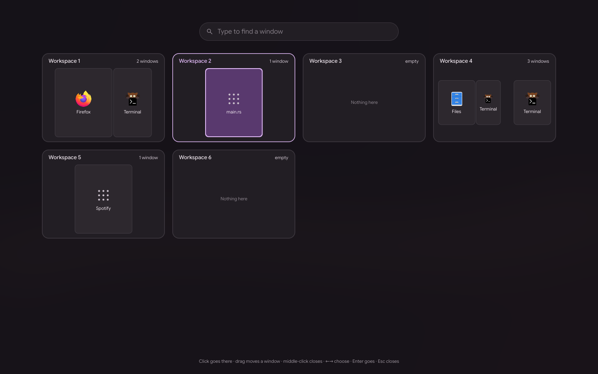</p>

- **Click** a window to focus it, or a card to switch to that workspace.
- **Drag** a window onto another card to move it there.
- **Middle-click** or Delete closes a window.
- **Type** to find a window by title or app.

Resting the pointer on a workspace dot in the bar shows a smaller version of its card. niri
offers no per-window capture, so these are maps rather than live thumbnails.

## The desktop

### Wallpapers

Your picture on every output (`cover`, `contain` or `stretch`). Without one, Asterism draws a
quiet gradient in the scheme's colours, or, with `world = true`, a painted landscape. The
changer (Mod+W, the control centre's Wallpaper tile, or `asterism msg wallpaper`) shows your
folder as a grid of thumbnails.

<p align="center"></p>

- **Pick one**: click it, or use the arrows and Enter. It applies at once, colours and all.
- **Random**: Shuffle, R, or Mod+Shift+W picks one at random.
- **Rotation**: `[wallpaper] interval` changes it by itself every few minutes.

Your choice is remembered without touching your config.

**Every change animates**, a different way each time: fade, wipe, a growing circle, blinds,
spreading ink, pixels turning over, or a slide. Choose one (or none) with
`[wallpaper] transition`, and the length with `transition_ms`.

<p align="center">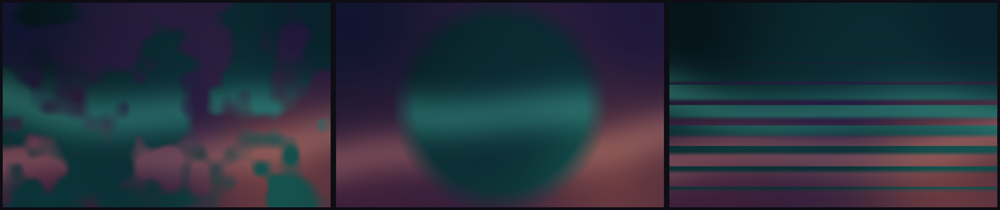</p>

**Live wallpapers.** A video (mp4, webm, mkv, mov…, played through `ffmpeg`) or an animated GIF
works like any picture: pick it in the changer (it has a small play mark), and the colours
come from its first frame. It plays only while it's worth it:

- **Covered by windows**, it all but stops: the compositor no longer asks for frames (niri
  slows them to about one a second).
- **On battery** it holds still (`live_battery = true` plays anyway); so it does while the
  screen is **locked**, or after `live_idle` minutes without input (5 by default).
- Held a minute, the player is put away entirely, and starts again when you're back.

Videos are decoded at half the screen's width and height by default and scaled up by the
compositor (`live_scale`, 25–100 %), at `live_fps` frames a second (30); big GIFs are shrunk the
same way. A video costs about a quarter of one core and 75–150 MB in `ffmpeg` while it plays;
smaller and slower costs less. `live = false` keeps the first frame still. All of it is in
Settings → Wallpaper.

### Widgets

Small cards on the wallpaper, under your windows:

- a big clock, the weather, and a month calendar
- what's playing, with synced lyrics (from LRCLIB)
- a music visualizer, in a card or along the foot of the screen
- the machine's load
- a photo frame, from a folder
- a sticky note

<p align="center">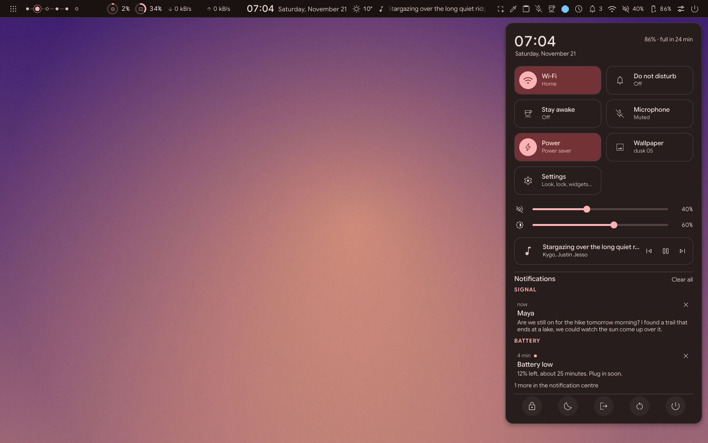</p>

**To arrange them**, right-click the desktop and choose *Arrange widgets*, press Arrange in
Settings → Desktop, or run `asterism msg widgets edit`. The screen dims and each widget gets a
frame:

- Drag a widget to move it (it snaps to an 8 px grid).
- Drag its sides or corners to resize it, to any width and height: a wider or taller card gives
  its contents room (a tall weather card shows the days ahead, a big note more lines), and the
  words grow as far as both ways allow. No limit but the screen (and a sliver small enough to
  still catch). The clock keeps its shape.
- × takes it off; the strip at the top adds the others.
- Esc, Enter or Done finishes.

<p align="center"></p>

**Their background** can be anything from solid to see-through: `[widgets] opacity` (0–100 %,
60 by default, or Settings → Desktop → Their look → Background). Below 40 % the words get a soft
shadow so a busy wallpaper doesn't swallow them; at 0 only the words (and the hairline round
each card, unless `outline = false`) are left. The sticky note's paper fades with them.
**Blur** (`blur = true`, Settings → Look → Frosted glass → Desktop widgets) frosts what's behind each card,
shaped to its corners; it's the compositor's, so niri 26 or another that offers
ext-background-effect (on Hyprland: `layerrule = blur, asterism-desktop`). With a light
background (20–40 %) it reads as frosted glass.

The visualizer listens to what your speakers play (`parec` or `pw-record`), only while it's shown
and music is playing. The sound never leaves the shell, and it doesn't show as a microphone in use.

### Desktop menu

Right-click the wallpaper for *Arrange widgets*, *Change wallpaper*, *Another wallpaper* and
*Settings*. Right-click a widget and the menu starts with that widget's own items: remove it,
write the note, or show the next photo. (Pictured under
[Notifications and on-screen cards](#notifications-and-on-screen-cards).)

### Colours for your apps

With `[colors] apps` (or the switches in Settings → Look), the scheme is written for **kitty**,
**foot**, **Alacritty** and **GTK** as files of their own (`asterism-colors.conf`, `.ini`,
`.toml`, `.css`). Your own configs are never edited: include the file once (Settings shows the
exact line) and the app follows every wallpaper change. The sixteen terminal colours keep their
meaning (red stays red), leaning gently toward the wallpaper.

### Night light

Warmer colours in the evening through the compositor's gamma control, with no extra program.
Toggle it from the control centre, or set `[night_light] mode = "schedule"` to warm the screen
from sunset to sunrise (or set times), easing over 20 minutes. Asterism holds the gamma control
only while warming, so calibration tools keep working the rest of the time.

## Pets

Optional companions that live on the screen above your windows, as many as you like: a **cat**,
a **fox**, a **bird**, a **panda**, a **tiger** or a **lion**, drawn by Asterism itself. Each has
real coats to choose from (tabby, ginger, black, white, tuxedo or Siamese cat; red or arctic fox;
sparrow, robin or bluebird; giant or brown panda; Bengal or white tiger; lion or lioness) or the
wallpaper's colours.

<p align="center">
  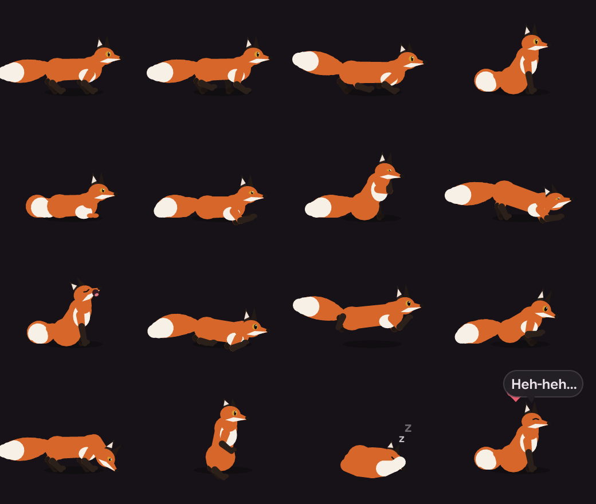
  
  
</p>

**It behaves like a pet:**
- **Moods:** it has energy, hunger and a need for company. It naps when tired, asks to be fed,
  and comes looking for you when ignored.
- **Everyday life:** it loafs, grooms, stretches and yawns. It falls asleep while you're away,
  gets the zoomies when the machine is busy, sways to music, and perks up at notifications.
- **Your pointer:** over the desktop and the bar, it chases the pointer, and crouches and
  pounces when it's near.
- **Small movements:** it eases into a walk and slows to a stop, turns round rather than
  flipping, stops on the way to look about or sniff, and while still it glances back, looks up,
  flicks an ear or the tip of its tail, tilts its head, shifts its weight.

**What you can do with it:**
- **Click** it to stroke it: it purrs.
- **Drag** it to pick it up: it dangles and lands on its feet.
- **Right-click** it to *feed* it, *play* (a ball or yarn), give it a *bed*, choose *another
  animal*, add *another pet*, open its settings, or *put it away*.

It speaks now and then with synthesized meows, trills, purrs, yips, chirps, roars, chuffs,
growls or bleats. They're quiet, and silent in do-not-disturb and while the screen is locked.

**More pets** keep each other company: hellos, games of chase, naps side by side. There's no
limit (`[pet] pets = ["cat:ginger", "panda", "lion"]`); each one costs about half a percent of
a core while it moves, and very little while it sits or sleeps. While the pets sit still their frames step rather than glide, so they cost almost nothing.

Set them up in Settings → Pets: your pets as pictures of themselves (click one to change its
animal or coat, × to put it away, + to add one from a gallery of the animals), or in `[pet]`;
the commands are in the [Command reference](#command-reference).

## Notifications and on-screen cards

Asterism is the **notification daemon** when no other one is running. Pop-ups show pictures and
action buttons, critical ones stay until answered, and pointing at a pop-up holds it.

The centre (the bell, Mod+N) has *do not disturb* and *clear all*. Per-app rules
(`[notifications.apps]`, or Settings) can keep an app quiet or drop its notifications. If
another daemon is running (mako, swaync, another shell), Asterism leaves notifications to it.

<p align="center">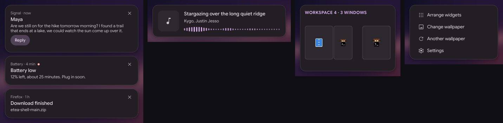</p>

Other cards, from left to right after the pop-ups:
- **New song:** its cover and name for a few seconds when the track changes (`song_popup = false` turns it off).
- **Workspace preview:** shown when you rest the pointer on a workspace dot.
- **Desktop menu:** from a right-click on the wallpaper.
- **Levels:** volume, brightness and keyboard-layout changes show a small level from any source.

<p align="center">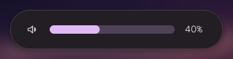</p>

## Settings

The control centre's Settings tile, the gear in the bar, or `asterism msg settings`. Settings is
an ordinary window, tiled and moved like any app. Its pages: Look, Bar, Wallpaper, Desktop,
Dock, Pets, Night light, Lock, Notifications, Weather and Timers.

<p align="center"></p>

- **Grouped:** each page is split into titled groups, each on a card of its own (Bar has Layout,
  Arrangement, What it shows, Clock, Corners and Day panel, for instance).
- **Only what applies:** a setting appears when it does something: night light's hours only on
  a schedule, the moving wallpaper's frame rate only while they play, a widget's own settings
  only while it's on the desktop, and so on. Empty fields show what's used instead.
- **Pets** are chosen by picture: your pets drawn as themselves, the coats drawn too, and a
  gallery of the animals to add one.
- **Search:** type anywhere in the window to search every page; each result says where it lives
  ("Bar › Corners").
- **Saving:** each change is written to `config.toml` at once, keeping your comments and order.
- **Window rules:** the app id is `asterism-settings`. For example, to open it floating on niri:

```kdl
window-rule {
    match app-id="^asterism-settings$"
    open-floating true
}
```

## Dashboard

Click the CPU or memory ring, or run `asterism msg dashboard`.

- **Graphs** of processor, memory, graphics and network over the last two minutes.
- **Disks:** how full each one is.
- **What's running,** sorted by CPU or memory. *End* stops one of your processes; it asks twice,
  and never offers to end the session itself (niri, systemd, PipeWire…).

<p align="center">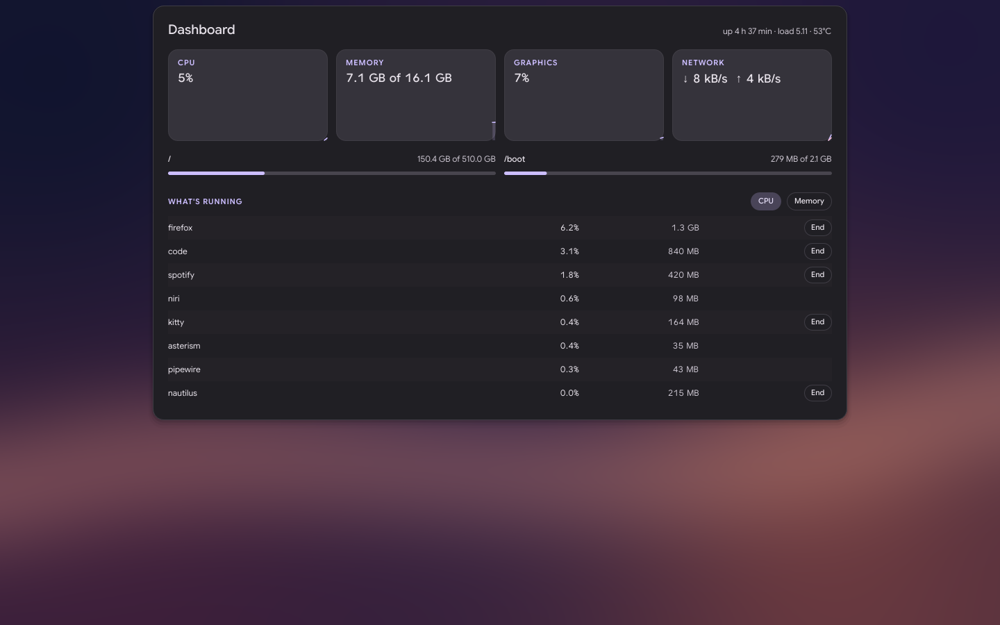</p>

## Clipboard and shortcuts

**Clipboard history:** the tools' clipboard button, Mod+Ctrl+V, or `asterism msg clipboard`.

- **What it keeps:** text and pictures, newest first. Type to search, Enter puts one back, Delete
  forgets it.
- **Privacy:** it lives in memory only (never written to disk), up to 50 entries with at most 8
  pictures. Anything a password manager marks as secret is never read.

<p align="center"></p>

**Keyboard shortcuts:** Mod+Shift+/ or `asterism msg shortcuts`. A sheet of your compositor's
own bindings (niri's `binds { }`, Hyprland's `bind =` lines), grouped and drawn as keycaps.
Type to narrow it down.

<p align="center">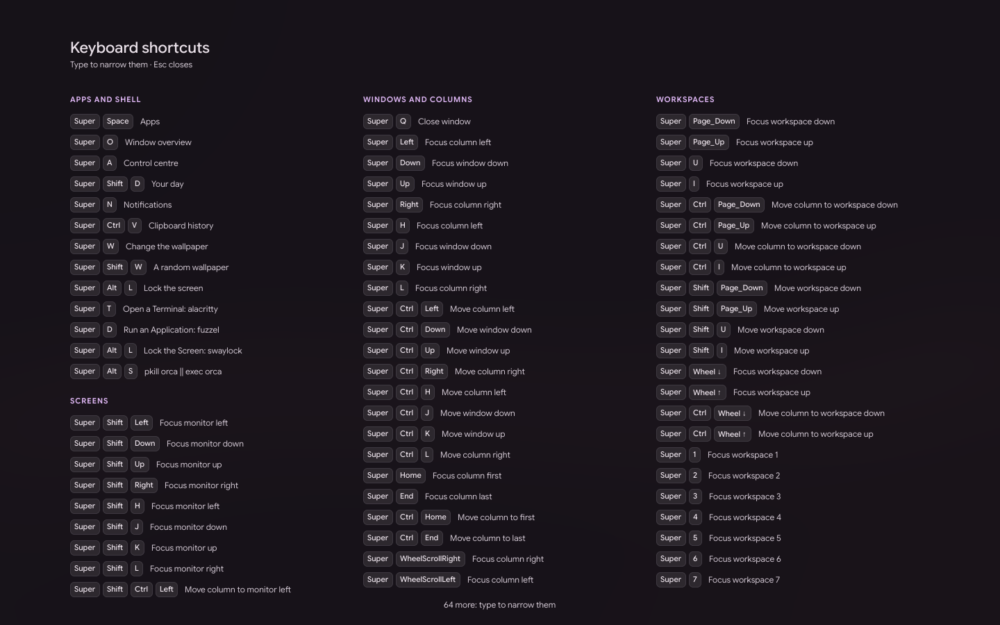</p>

## Timers and weather

**Timers:**
- **Countdown:** 1 minute to 2 hours, add a minute, pause.
- **Focus:** 25 minutes on, 5 off, 15 after every fourth round; all set in `[timers]`.
- **Stopwatch,** with laps.

A running timer shows as a ring in the bar, and a notification says when time is up. Start them
from the bar's timer menu, the day panel, or `asterism msg timer 25`, `focus` or `stopwatch`.

**Weather** comes from Open-Meteo, for `[weather] city` (or `latitude`/`longitude`), else the city
your time zone is named after. The bar shows the temperature. Its menu adds the feel, humidity,
wind, sunrise and sunset, and five days ahead.

## Security and devices

<p align="center">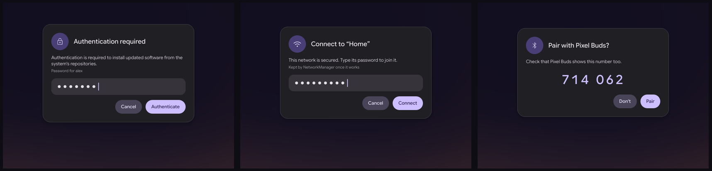</p>

### Lock screen

The lock screen shows your wallpaper dimmed, the time, your name and a password field.

**When it locks:**
- on Mod+Alt+L or `asterism msg lock`
- when logind asks (`loginctl lock-session`)
- before the machine sleeps, so closing the lid locks too
- after `[lock] idle` minutes without input ("Stay awake" holds that off)

**How it's protected:**
- It runs as a **separate process** (`asterism-lock`), so nothing that happens to the bar can
  unlock the screen or lock you out.
- Your password is checked by the system's **`unix_chkpwd`** helper, the one PAM screen lockers
  rely on. Asterism never reads `/etc/shadow` and links no PAM.
- **Fingerprint** unlock works through fprintd when a supported reader has a finger enrolled.
- **Recovery:** if it ever won't take your password, switch to a console (Ctrl+Alt+F3), log in,
  and run `asterism unlock`.

### Polkit

When an app needs administrator rights, Asterism asks for the password on a card. The password
is checked by polkit's own helper, never by Asterism, and wiped from memory once used. If another
agent already serves your session, Asterism leaves it be; `polkit_agent = false` turns this off.

### Wi-Fi

A secured network you haven't joined before asks for its password on a card. The password goes
to NetworkManager over D-Bus, never on a command line, and is kept only if it works. A wrong one
lets you try again. Saved VPNs get a switch in the network menu and a control-centre tile.

### Bluetooth

Opening the Bluetooth menu scans for 30 seconds. Click a nearby device to pair, trust and
connect it in one go.

Asterism is BlueZ's pairing agent, so whatever a device asks comes up on a card: a number to
compare, a PIN to type, or whether to let it in. Paired devices show their battery level and warn
when it runs low. Right-click a device twice to forget it.

## Screenshots, recording and text capture

The tools' screenshot button opens a menu:

- **Screenshot** of a region you choose, the whole screen, or the focused window. On niri this
  uses niri's own screenshot UI; on Hyprland, grim and slurp. A notification shows each one with
  a thumbnail.
- **Record** the screen, with or without sound (needs `wf-recorder`). The bar shows a red dot
  and the time; click it to stop. Recordings go to `~/Videos/Recordings`.
- **Copy text from a region:** select an area and its text is recognised and copied (needs
  `slurp`, `grim` and `tesseract`). The image goes through a pipe, never to disk.

From the command line: `asterism msg screenshot [region|screen|window]`, `record [audio]` and
`screen-text`.

## Privacy

Only these leave your machine, and only when you use the feature:

| What | Sent to | Contains |
|---|---|---|
| Weather | [Open-Meteo](https://open-meteo.com) | The city you set (or your time zone's), then its coordinates |
| Synced lyrics | [LRCLIB](https://lrclib.net) | The playing song's artist, title, album and length (`[widgets] lyrics = false` stops it) |
| Album covers | The address the player gives | Whatever the player points at |
| `?` searches in the launcher | Your search engine (`[launcher] search`) | Your question |

Nothing looks you up by IP address, and nothing else is sent anywhere. Clipboard history is
never written to disk; passwords are zeroed in memory after use and never logged.

## Performance

Measured on a 1920×1200 laptop with the wallpaper, the dock and five pets out:

| | |
|---|---|
| Memory | ~27 MB resident, of which ~19 MB is the program and its fonts (file-backed, shared); ~6 MB its own |
| CPU at rest | ~0.3 % of one core |
| CPU with pets about | about 0.5 % for each one moving (much less while they sit or sleep) |
| Wallpaper transition | 2–6 ms per frame at 1920×1200 |
| Live wallpaper, video | about ¼ of a core and 75–150 MB in `ffmpeg` at half size and 30 fps; nothing while held still |
| Live wallpaper, GIF | decoded in the shell; a full-HD GIF adds ~20 MB, small ones next to nothing |
| Blur | done by the compositor: nothing in the shell |

How it stays light:
- **Damage tracking:** pieces of the UI are cached and only changed rectangles are redrawn and
  sent.
- **Buffers:** large surfaces get buffers of their own, which are freed when the surface goes.
- **Pictures:** decoded wallpapers are handed back to the system as soon as they've been painted.
- **Pets:** each moves on by its own clock (a sleeping one a few times a second, a running one
  thirty), and only the corner of its surface it covers is painted and sent. Built-in fonts are
  read where they lie in the program, not copied.
- **Out of sight, out of work:** the dock draws and sends nothing while it's down, and wakes
  only for news it shows (windows, icons, the trash). A live wallpaper gets no frames while
  windows cover it, holds still on battery, locked or while you're away, and after a minute of
  that its player is put away altogether.

## Requirements

**Compositor:** niri, or Hyprland. On Hyprland 0.55+ dispatchers use the Lua form, older versions
the plain form; Asterism detects which one works.

**To build:** Rust 1.88 or newer. The only system library linked is **libxkbcommon**, which every
Wayland desktop already has.

**At run time**, all optional; features appear when their tools are found:

| For | Needs |
|---|---|
| Sound, per-app volume | `pactl` (PipeWire's pulse server or PulseAudio) |
| Network, VPN, battery, power profiles | NetworkManager, UPower, power-profiles-daemon (D-Bus) |
| Bluetooth and pairing | BlueZ, with `bluetooth.service` running |
| Lock screen · fingerprint | `unix_chkpwd` (part of Linux-PAM) · fprintd |
| Weather, lyrics, album covers | `curl` |
| Copying from the launcher | `wl-copy` |
| Music visualizer · pet sounds | `parec` or `pw-record` · `pw-play` or `paplay` |
| Recording · Hyprland screenshots · text capture | `wf-recorder` · `grim`, `slurp` · plus `tesseract` |
| Kanji workspaces · emoji | a CJK font (e.g. Noto Sans CJK) · a colour emoji font (e.g. Noto Color Emoji) |
| Video wallpapers | `ffmpeg` (GIFs need nothing) |

## Installation

```sh
git clone https://github.com/sanjay-np/asterism.git && cd asterism
cargo build --release
install -Dm755 target/release/asterism ~/.local/bin/asterism
mkdir -p ~/.config/asterism && cp config.example.toml ~/.config/asterism/config.toml
```

### Starting with your session

**niri** (`~/.config/niri/config.kdl`). niri may not have `~/.local/bin` on its `PATH`, so use
the full path:

```kdl
spawn-at-startup "/home/you/.local/bin/asterism"
```

**Hyprland, Lua config (0.55+)**:

```lua
hl.on("hyprland.start", function()
    hl.exec_cmd("asterism")
end)
```

**Hyprland, hyprlang (before 0.55)**:

```ini
exec-once = asterism
```

**systemd**, for either compositor when your session reaches `graphical-session.target`
(niri-session, uwsm):

```sh
install -Dm644 contrib/asterism.service ~/.config/systemd/user/asterism.service
systemctl --user enable --now asterism.service
```

### Updating

After a rebuild, run the `install` line again, then restart the shell:

```sh
pkill -x asterism; setsid -f ~/.local/bin/asterism
```

Restarting never touches an open lock screen, which runs as its own process. Apps started from
the launcher keep running.

### Coming from another shell

1. **Stop it starting:** comment out the other shell's startup line.
2. **Move your keybindings** to `asterism msg …` (next section).
3. **Check the lid switch.** If it used to ask the old shell to lock and suspend, it now does
   nothing. Asterism locks before any sleep by itself, so plain suspend is enough:

```kdl
switch-events {
    lid-close { spawn "systemctl" "suspend"; }   // Asterism locks first
}
```

Other bars can run alongside. If one already owns the tray, Asterism joins as a second host; if
another program is the notification daemon, Asterism leaves notifications to it.

## Keybindings

**niri** (inside `binds { }`; use the full path to `asterism` if it isn't on niri's `PATH`).
These keys are free in niri's default config:

```kdl
Mod+Space hotkey-overlay-title="Apps" { spawn "asterism" "msg" "launcher"; }
Mod+O hotkey-overlay-title="Window overview" { spawn "asterism" "msg" "overview"; }
Mod+A hotkey-overlay-title="Control centre" { spawn "asterism" "msg" "control"; }
Mod+Shift+D hotkey-overlay-title="Your day" { spawn "asterism" "msg" "day"; }
Mod+D hotkey-overlay-title="Dock" { spawn "asterism" "msg" "dock"; }
Mod+N hotkey-overlay-title="Notifications" { spawn "asterism" "msg" "notifications"; }
Mod+Ctrl+V hotkey-overlay-title="Clipboard history" { spawn "asterism" "msg" "clipboard"; }
Mod+W hotkey-overlay-title="Change the wallpaper" { spawn "asterism" "msg" "wallpaper"; }
Mod+Shift+W hotkey-overlay-title="A random wallpaper" { spawn "asterism" "msg" "wallpaper" "random"; }
Mod+Shift+Slash hotkey-overlay-title="Keyboard shortcuts" { spawn "asterism" "msg" "shortcuts"; }
Mod+Alt+L hotkey-overlay-title="Lock the screen" { spawn "asterism" "msg" "lock"; }
Mod+Shift+Escape { spawn "asterism" "msg" "menu" "session"; }
```

Volume, brightness and media keys can stay on `wpctl`, `brightnessctl` and `playerctl`, since
Asterism shows the level for changes from any source. Or route them through it:

```kdl
XF86AudioRaiseVolume allow-when-locked=true { spawn "asterism" "msg" "volume" "up"; }
XF86AudioLowerVolume allow-when-locked=true { spawn "asterism" "msg" "volume" "down"; }
XF86AudioMute allow-when-locked=true { spawn "asterism" "msg" "volume" "mute"; }
XF86AudioMicMute allow-when-locked=true { spawn "asterism" "msg" "mic" "mute"; }
XF86MonBrightnessUp allow-when-locked=true { spawn "asterism" "msg" "brightness" "up"; }
XF86MonBrightnessDown allow-when-locked=true { spawn "asterism" "msg" "brightness" "down"; }
XF86AudioPlay allow-when-locked=true { spawn "asterism" "msg" "media" "play-pause"; }
XF86AudioNext allow-when-locked=true { spawn "asterism" "msg" "media" "next"; }
XF86AudioPrev allow-when-locked=true { spawn "asterism" "msg" "media" "previous"; }
```

**Hyprland**: the same commands through `exec`, for example in hyprlang:

```ini
bind = SUPER, SPACE, exec, asterism msg launcher
bind = SUPER, O, exec, asterism msg overview
bind = SUPER, A, exec, asterism msg control
bind = SUPER SHIFT, D, exec, asterism msg day
bind = SUPER, D, exec, asterism msg dock
bind = SUPER ALT, L, exec, asterism msg lock
bindel = , XF86AudioRaiseVolume, exec, asterism msg volume up
bindel = , XF86MonBrightnessUp, exec, asterism msg brightness up
```

A menu opened by a key takes the keyboard: use the arrows and Enter, and close it with Esc or
the same key again.

## Configuration

Everything lives in `~/.config/asterism/config.toml`, and the Settings app writes there too.
[config.example.toml](config.example.toml) documents every option with comments. Changes apply
within two seconds, with no restart.

| Section | Covers |
|---|---|
| *(top level)* | `style`, `size`, `position`, `page_style`, `font`, `icons`, `hot_corner`, `outputs`, `song_popup` |
| `[clock]` · `[layout]` | Clock format; which modules sit left, centre and right |
| `[commands]` | Commands for settings, lock, suspend, log out, reboot, power off |
| `[notifications]` · `[notifications.apps]` | Daemon, timeouts, battery warnings; per-app rules |
| `[wallpaper]` | Image (a picture, a video or a GIF), fit, folder, rotation interval, transitions; live wallpapers: on/off, frame rate, size, on battery, still when away |
| `[colors]` | Accent, role overrides, icon and widget tinting, app colour files |
| `[launcher]` · `[weather]` · `[timers]` | Terminal and search engine; place and units; focus lengths |
| `[lock]` · `[night_light]` | Idle minutes, before sleep, fingerprint; schedule and temperature |
| `[widgets]` · `[day]` · `[pet]` | Desktop widgets, their background's opacity, outline and blur; the to-do folder and corner; the pets |
| `[dock]` | On or off, pinned apps, position, hiding and its delay, open apps, the apps button and the trash; icon size, magnify, corners, background, attached, indicator, separators |
| `[blur]` | Frosted glass behind the dock, launcher, overview, wallpaper picker, control centre and notifications |

The settings you're most likely to change first:

```toml
style = "line"            # line, frame, floating, islands or transparent
page_style = "dots"       # dots, numbers or kanji

[layout]
left = ["launcher", "pages"]
center = ["resources", "clock", "weather", "media"]
right = ["tools", "tray", "status"]

[wallpaper]
image = "~/Pictures/Wallpapers/sea.jpg"   # the colours come from it
interval = 0                              # minutes between automatic changes; 0 = never

[lock]
idle = 10                 # minutes without input before locking; 0 = never

[widgets]
show = ["clock", "weather", "media"]

[dock]
pinned = ["firefox", "kitty", "org.gnome.Nautilus"]   # desktop file ids, in order

[colors]
# accent = "#4a6fd9"      # grow the scheme from this colour instead of the wallpaper
```

## Command reference

`asterism msg COMMAND` drives the running shell (one per Wayland display), for keybindings and
scripts. `asterism msg help` prints this list.

| Command | Does |
|---|---|
| `launcher`, `control`, `day`, `overview`, `dashboard`, `settings`, `clipboard`, `shortcuts` `[open\|close]` | Toggle (or open / close) that panel |
| `menu NAME` | Toggle a bar menu: `calendar`, `media`, `sound`, `network`, `bluetooth`, `power`, `session`, `machine`, `traffic`, `keyboard`, `notifications` |
| `notifications [clear]` · `dnd` | Notification centre, or clear it · toggle do not disturb |
| `volume up\|down [PERCENT]` · `volume mute` · `mic mute` | Change volume (and show it) · mute · mute the microphone |
| `brightness up\|down [PERCENT]` · `osd volume\|brightness` | Change brightness · show a level without changing it |
| `media play-pause\|next\|previous` | Control the player the bar follows |
| `wallpaper [open\|close]` · `wallpaper next\|previous\|random` · `wallpaper set PATH` | The changer · step · set a picture |
| `widgets [edit\|done]` | Arrange the desktop's widgets, or finish |
| `dock [show\|hide]` | Bring the dock up for a moment, put it away, or toggle it |
| `bar arrange [on\|off]` | Arrange mode: drag the bar's items about; Done or the same command finishes |
| `night-light [on\|off]` · `awake` | Night light · keep the screen awake |
| `lock` | Lock the screen |
| `screenshot [region\|screen\|window]` · `screen-text` · `record [audio]` | Capture · copy text from a region · start or stop recording |
| `timer MINUTES` · `timer pause\|cancel` · `focus` · `stopwatch [lap\|reset]` | Timers |
| `pet feed\|play\|yarn\|bed\|nobed` · `pet add [ANIMAL[:COAT]]` · `pet [N] next\|away` | Pets and their things |
| `reload` · `ping` | Re-read the config · check the shell is running |

Other entry points: `asterism lock` runs the lock screen alone, `asterism unlock` releases it
(the recovery path), and `asterism --snapshot` renders the UI to a PNG (see Development).

## Troubleshooting and known limits

**Locked out?** Switch to a console with Ctrl+Alt+F3, log in, run `asterism unlock`, then switch
back to your session (often Ctrl+Alt+F1 or F2).

**Asterism won't start, saying it's already running.** Only one shell per display is allowed;
`asterism msg ping` answers if one is up. Use `pkill -x asterism` to stop it.

**No notification pop-ups.** Another daemon owns the notification name (mako, swaync, dunst,
another shell); Asterism steps aside on purpose. Stop the other one and restart Asterism.

**Something is missing from the bar.** Run with `RUST_LOG=debug asterism` to see which services
and tools were found.

**A live wallpaper doesn't move.** On battery it holds still unless `[wallpaper] live_battery =
true` (Settings → Wallpaper → Play on battery); it also stops while locked and after
`live_idle` minutes without input. Videos need `ffmpeg`. A GIF of a single frame is a picture.

**Blur doesn't show.** The compositor has to offer ext-background-effect (niri 26 and later);
`RUST_LOG=debug asterism` logs "compositor blur behind surfaces: true" when it does. On
Hyprland use the layer rules in [Look and feel](#look-and-feel). Opaque cards hide a blur: the
widgets need a low `opacity`, the others are made see-through for you.

**Known limits:**
- No 802.1X (enterprise) Wi-Fi.
- Notification bodies are plain text, with no inline reply.
- The overview and workspace previews are window maps, not live thumbnails (niri has no
  per-window capture).
- Clipboard history is empty after a restart, by design.
- The wallpaper changer lists one folder (PNG, JPEG, GIF and videos). There is one picture for
  all outputs.
- Live wallpapers are drawn by the processor (shared memory, no GPU surfaces: that would mean
  linking EGL), so a video costs more than in a GPU player like mpvpaper; keep it at half size.
- Pets see the pointer only over the shell's own surfaces, since Wayland keeps the pointer's
  position over other windows private.
- The day panel's notes are typed at the end only. For heavier editing, open `notes.md`.
- The dock lives on one output (the one in use when it first appears), and, hidden, comes out
  from the part of the edge right by it, not the whole edge. On the same edge as the bar it
  sits just inside the bar, and comes out from the bar's inner edge. Its trash counts your home
  trash only.
- Hyprland support is tested against its IPC, less in daily use than niri.

## Development

```sh
cargo run --release                       # run it (refuses to start twice)
cargo test --release                      # 69 tests, plus 3 opt-in timing/sample tests (--ignored)
cargo clippy --release                    # kept warning-free
cargo run --example fixtures -- 60        # a fake music player and tray app for a minute
RUST_LOG=asterism::app=trace asterism     # per-frame timings
```

**Snapshot mode** renders the real UI with live data and no compositor, which is how every
picture in this README was made:

```sh
asterism --snapshot bar.png                                     # the bar
asterism --snapshot m.png --menu sound                          # a menu
asterism --snapshot p.png --panel overview --demo               # a panel: launcher, control, day, overview,
                                                                # dashboard, settings, wallpapers, clipboard,
                                                                # shortcuts, toasts, osd, auth, wifi, pair,
                                                                # song, peek, deskmenu ([--query TEXT])
asterism --snapshot d.png --panel wallpaper --menu control      # the whole desktop with a menu or panel in place
asterism --snapshot e.png --panel widgets --hover widget.media  # arranging widgets
asterism --snapshot t.png --panel transition --query ink@0.3    # a frame of a wallpaper transition
asterism --snapshot f.png --panel pet --query fox:red --scale 2 # a pet in every pose
```

`--demo` replaces your workspaces, windows, networks, processes and to-do list with made-up ones,
for screenshots you can share.

### Code map

More detail on architecture and conventions is in [AGENTS.md](AGENTS.md).

| Path | What's there |
|---|---|
| `src/app/` | Wayland: bars per output, menus, panels, widgets, wallpaper, transitions and live wallpapers, compositor blur, pets, idle, clipboard, night light, damage tracking, buffers |
| `src/bar.rs`, `src/popups.rs` | Bar modules; menus, the control centre and the day panel |
| `src/launcher.rs`, `src/overview.rs`, `src/dock.rs` | App search, maths, emoji, the grid; the window overview; the dock |
| `src/cards.rs` | Notification pop-ups, levels, password and pairing cards, song and workspace cards |
| `src/lock.rs` | The lock screen, a process of its own |
| `src/services/` | niri and Hyprland IPC, MPRIS, tray, UPower, NetworkManager, BlueZ, pactl, notifications, polkit, logind, weather, lyrics, capture, /proc |
| `src/widgets.rs`, `src/dashboard.rs`, `src/settings.rs` | Desktop widgets; the dashboard; the Settings app and its comment-preserving config writer |
| `src/day.rs`, `src/clipboard.rs`, `src/shortcuts.rs` | To-do and notes files; clipboard history; the shortcuts sheet |
| `src/wallpapers.rs`, `src/transition.rs`, `src/palette.rs`, `src/appcolors.rs` | The changer; transitions; the scheme from the wallpaper; colour files for apps |
| `src/live.rs` | Live wallpapers: the video (`ffmpeg`) and GIF players, paced and asked frame by frame |
| `src/pet/` | The pets: behaviour, drawing, synthesized voices |
| `src/ui.rs`, `src/render/` | Pieces, primitives, actions, animation; tiny-skia drawing, text, icons |
| `src/theme.rs`, `src/config.rs` | Colour roles and sizes; the configuration |

## Credits and licence

Asterism began as a rewrite of the top bar of [ETEA Shell](https://github.com/SDcold/etea-shell)
by SDcold, and its layout and much of its feature list still owe a lot to it. The frame style and
several features took cues from [cykler-caelestia](https://github.com/cykler01/cykler-caelestia).

Asterism is free software under the **GNU General Public License v3.0 or later**, the same as
ETEA (see `LICENSE`).

Bundled assets keep their own licences:
- **Fonts:** Google Sans Flex and Poppins, under the SIL Open Font License
  (`assets/fonts/GoogleSansFlex-OFL.txt`, `assets/fonts/OFL.txt`).
- **Icons:** Material outline icons and Material Symbols, under Apache 2.0
  (`assets/icons/outline/LICENSE.txt`, `assets/icons/material/LICENSE.txt`); Phosphor, under MIT
  (`assets/icons/phosphor-fill/LICENSE.txt`).
- **Emoji names:** from Unicode's emoji-test.txt, under the Unicode License v3
  (`assets/emoji-LICENSE.txt`).

Weather data by [Open-Meteo](https://open-meteo.com); lyrics by [LRCLIB](https://lrclib.net).
The wallpapers in these screenshots are abstract gradients made for this README.
